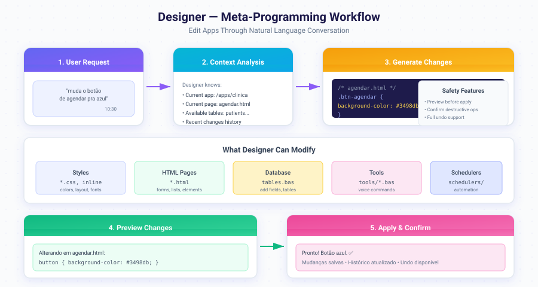

# Designer 🟡 BETA

Designer is an AI assistant that appears alongside your application. Use natural conversation to modify any aspect of your app without writing code.

---

## How It Works

Designer understands the context of your application. When you make a request, it knows which app you are viewing, which page is active, and what tables exist.

  

    

      
Change the schedule button to blue

      
10:30

    

  

  

    

      
Updating schedule.html:

      
.btn-schedule { background-color: #3498db; }

      
Button color changed to blue.

      
10:30

    

  

---

## What Designer Can Modify

| Category | Examples |
|----------|----------|
| **Styles** | Colors, layout, fonts, spacing |
| **HTML Pages** | Forms, lists, buttons, elements |
| **Database** | Add fields, create tables |
| **Tools** | Voice commands, chat triggers |
| **Schedulers** | Automated tasks, reports |

---

## Editing Styles

  

    

      
Make the colors more modern, blue tones

      
14:20

    

  

  

    

      
Updating styles.css:

      
Primary color: #2563eb

      
Secondary color: #3b82f6

      
Background: #f8fafc

      
Visual style updated.

      
14:20

    

  

---

## Adding Form Fields

  

    

      
Add an insurance field to the patient form

      
11:00

    

  

  

    

      
Making two changes:

      
<strong>1. tables.bas</strong> - new field:

      
insurance AS STRING

      
<strong>2. patients.html</strong> - new input added

      
Insurance field added to form.

      
11:00

    

  

---

## Creating Voice Commands

  

    

      
Create a command to see today's appointments

      
09:15

    

  

  

    

      
Creating .gbdialog/tools/todays-appointments.bas

      
Triggers: "today's appointments", "daily schedule"

      
Command created. Say "today's appointments" to use it.

      
09:15

    

  

---

## Creating Schedulers

  

    

      
Every day at 9am send reminders to today's patients

      
16:00

    

  

  

    

      
Creating .gbdialog/schedulers/daily-reminder.bas

      
Schedule: Every day at 9:00 AM

      
Action: Send reminder to patients with appointments today

      
Scheduler configured.

      
16:00

    

  

---

## Adding Database Fields

  

    

      
Add SSN field to the patients table

      
10:45

    

  

  

    

      
Updating tables.bas:

      
Adding: ssn AS STRING UNIQUE INDEX

      
Database synchronized.

      
Field available in all apps.

      
10:45

    

  

---

## Context Awareness

Designer tracks your current location and correlates follow-up requests.

| Context | How It Is Used |
|---------|----------------|
| **Current app** | Edits apply to that app's files |
| **Current page** | Defaults edits to that file |
| **Recent changes** | Correlates follow-up requests |
| **Available tables** | Knows your data structure |
| **Existing tools** | Knows voice commands already created |

  

    

      
Change the button to green

      
14:30

    

  

  

    

      
Changing button in schedule.html to green.

      
Button updated.

      
14:30

    

  

  

    

      
And add a notes field

      
14:31

    

  

  

    

      
Adding notes field to the same form.

      
Field added.

      
14:31

    

  

---

## Handling Sensitive Information

When Designer needs API keys or credentials:

  

    

      
Integrate with Stripe for payments

      
15:00

    

  

  

    

      
To integrate with Stripe, I need the API Key.

      
Do you want to provide it now or later?

      
15:00

    

  

  

    

      
Later

      
15:00

    

  

  

    

      
Saved as pending item.

      
Pending: Stripe API Key

      
You can provide it in Settings, Pending Items.

      
Payment structure created. When you provide the key, it will work automatically.

      
15:01

    

  

---

## Chat Reachability and Current Parity

Designer-style editing is not a separate chat protocol. Editor operations are
reached through the same declarative command surface as every other suite app:
the model emits a `{"__api_call__": {...}}` block, discovers a command with
`api.find`, and executes it with `api.exec` or a curated verb name
(`botserver/src/core/bot/api_catalog/commands_list/mod.rs:53-62`). There is no
dedicated BASIC keyword for undo, redo, confirm or track-changes: editor verbs
live in the API command catalog, not in `botbasic_*`.

The curated catalog is a set of `AppCommand` entries
(`botserver/src/apps/commands/app_command.rs:3-24`). Each entry carries an app
id, name, label, summary, **named parameters with free-text descriptions**, a
deep link and a single `admin_only` boolean. Verb-to-route bindings live in
`botserver/src/apps/commands/verb_endpoints/table/office_endpoints.rs`;
composite Docs and Sheet dispatchers live in
`botserver/src/core/bot/api_catalog/docs_verbs.rs` and
`botserver/src/core/bot/api_catalog/sheet_verbs.rs`.

Chat-reachable editor verb families today, taken from those bindings and
catalog entries:

| App | Representative verbs |
|-----|----------------------|
| Docs | `docs.list`, `docs.create`, `docs.update`, `docs.get`, `docs.save`, `docs.delete`, `docs.search`, `docs.outline`, `docs.collaborators`, `docs.ai`, `docs.footnote.add`, `docs.comment.add`, `docs.track_changes.enable`, `docs.compare`, `docs.toc.generate` |
| Sheet | `sheet.create`, `sheet.cells.set`, `sheet.get`, `sheet.import`, `sheet.export`, `sheet.chart.create`, `sheet.conditional_format.apply`, `sheet.pivot.create`, `sheet.delete` |
| Slides | `slides.create`, `slides.get`, `slides.slide.add`, `slides.slide.delete`, `slides.slide.duplicate`, `slides.slide.notes`, `slides.element.add`, `slides.media.add`, `slides.element.delete`, `slides.theme.set`, `slides.export` |
| Canvas | `canvas.list`, `canvas.get`, `canvas.create` |

`sheet.cells.set` additionally accepts `styles`, `formats`, `conditional` and
`chart`/`charts` and applies them to the same sheet in one call
(`sheet_verbs.rs:103-115` and `:203-246`).

Full parity with typed operations, scopes, confirmation and undo is **not**
claimed. Issue #2448 tracks the gap and its acceptance criteria were still
unverified at the last triage. Concretely, the following are **not**
implemented in the catalog today:

| Requirement (#2448) | Current state in source |
|---------------------|-------------------------|
| Typed request/response JSON schema per verb | `AppCommand.params` is `&[(&str, &str)]` — names and free-text descriptions only (`app_command.rs:14-15`); there is no schema field. |
| Scopes read/write/share/admin, resolved from role and enforced per verb | Only `admin_only: bool` (`app_command.rs:22-23`). The consent classifier derives read/delete/update from the verb suffix, not a per-verb scope (`consent_class.rs:6-13`). |
| Preview-then-confirm with a diff summary for destructive verbs | The consent gate emits a permission card carrying `{command, params}` detail (`consent_gate.rs:134-154`); no diff summary is generated. |
| One command undoes the last agent batch | `/api/editor/undo` exists (`endpoint_inventory_editor_email.rs:10`, `crates/boteditor/src/routes.rs:15`) but its stack is recreated on every request (`editor_registry()` in `crates/boteditor/src/handlers/mod.rs:70-72`), so it is not a persistent cross-request or agent-batch undo. |
| Idempotency keys for batch plans | No idempotency field exists in the command catalog. |
| Parity CI test (toolbar action mapped to a catalog verb) | No `data-verb` mapping test was found in the source tree. |

A mutating command can still prompt for permission: the `__api_call__` handler
runs a consent gate that classifies the action by verb suffix and returns a
pending request or a denial (`api_call/handle.rs:130-184`). This is a permission
prompt, not the preview-with-diff flow the parity epic requires.

---

## Limitations

| Limitation | Reason |
|------------|--------|
| Cannot delete entire app | Safety protection |
| Cannot access external systems without credentials | Security |
| Cannot modify system files | Isolation |
| Cannot execute arbitrary code | Security |

---

## Available Keywords

Designer uses GB BASIC keywords to implement changes:

| Category | Keywords |
|----------|----------|
| **Communication** | TALK, HEAR, SEND MAIL, SEND TEMPLATE |
| **Data** | FIND, SAVE, UPDATE, DELETE |
| **Automation** | SET SCHEDULE, ON CHANGE, ON EMAIL |
| **AI** | LLM, USE KB |
| **Web** | SCRAPE, GET, POST, RSS |
| **Memory** | SET BOT MEMORY, GET BOT MEMORY |
| **Control** | IF/THEN/ELSE, FOR EACH/NEXT, WHILE/WEND |

---

## Tips for Better Results

### Be Specific

| Less Effective | More Effective |
|----------------|----------------|
| "improve the form" | "add email validation to the form" |
| "change the colors" | "change the main button to green" |
| "fix this" | "increase the font size in the table" |

### Combine Requests

  

    

      
Add SSN field to patient form with mask and validation, and show it in the list too

      
10:00

    

  

  

    

      
Making 3 changes:

      
1. tables.bas - new SSN field

      
2. patients.html - input with mask XXX-XX-XXXX

      
3. patients.html - SSN column in the table

      
All changes applied.

      
10:00

    

  

---

## Next Steps

- [App Generation](./app-generation.md) — How apps are created
- [Task Workflow](./workflow.md) — How tasks are processed
- [Data Model](./data-model.md) — TABLE keyword reference