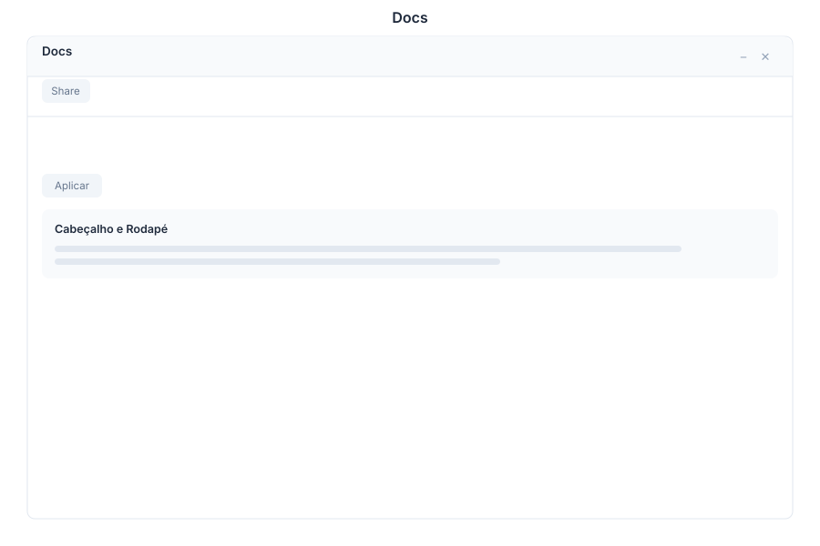

# Docs 🟡 PREVIEW — IN TEST

> **In test.** Docs is a preview application and is **not part of the supported surface**. It is functional and actively being tested, but behaviour and interface may change, and edge cases are not guaranteed. Decide accordingly before depending on it.

Docs is the suite's collaborative document editor: rich text, comments, tracked changes and citation support, with AI assistance.

## What the shipped editor exposes

Verified from the app's own toolbar and module layout (`botui/ui/suite/docs/`).

### Editing

| Capability | Notes |
|---|---|
| Formatting | Rich text with headings, quotes, lists, inline code and links |
| Find & Replace | Search within the document |
| Undo / Redo | Standard history |
| **Track Changes** | Record edits as suggestions rather than applying them silently |
| **Compare Documents** | Diff two documents against each other |
| **Version history** | Browse and restore earlier states |
| Activity log | What happened to the document, and when |
| Export | Toolbar Export menu downloads the active document as `.docx`, `.odt`, `.pdf`, `.html`, Markdown or plain text; if the document has no stored copy the editor content is exported instead |

### Structure and content

| Capability | Notes |
|---|---|
| Table of Contents | Generated navigation for the document |
| Header & Footer | Page furniture |
| Insert Table / Image | Structured and visual content |
| Insert Equation | Mathematical notation |
| Insert Footnote / Endnote | Scholarly referencing |
| Insert Page Break | Page control |
| From Template | Start from an existing template |

### Collaboration

| Capability | Notes |
|---|---|
| Collaborators & follow | See who is in the document and follow their cursor |
| Comments | Discussions attached to a position in the text |
| Presence | Collaborator indicators when a realtime collaboration endpoint is configured; the shipped server exposes REST presence/comments and no `/ws/{app}` collaboration socket, so the editor reports offline instead of retrying a missing route |

### Sharing

The Share control opens the shared access dialog (people grants, public links,
ownership transfer). A **public link** is read-only by design:

| Behaviour | Where it is implemented |
|---|---|
| The dialog mints a token and copies `…/suite/docs/shared.html?link=<token>` | `botui/ui/suite/js/collab-share.js` (`POST /api/collab/links`), `botui/ui/suite/docs/shared.html` |
| Opening the link renders the document in a standalone viewer with **no toolbar and no editor**, marked **Read-only** | `botui/ui/suite/docs/shared-viewer.js` |
| The server resolves the token — never a document id in the URL — and returns the body with `read_only: true` | `GET /api/docs/shared/:token` in `botserver/crates/botdocs/src/shared_link.rs` |
| The link cannot write: every mutating Docs route requires a signed-in `DocUser`, and the token route is declared a capability (read methods only) | `botserver/crates/botsecurity-auth/src/auth_api/public_routes.rs` |
| The Share button shows a dot while a read-only link is active | `botui/ui/suite/docs/modules/15_readonly.js` |

Links can be revoked in the same dialog; expired, revoked and unknown tokens all
answer `404`, so a link never reveals whether a document exists.

### References and AI

| Capability | Notes |
|---|---|
| Citations & References | Source management inside the document |
| AI Assistant | Ask for edits and improvements in natural language. When the deployment has no LLM configured the panel says the document was not changed and points at the matching control — it never returns a fake rewrite, translation or summary. Summarize falls back to an honest excerpt of the selection. |

Localisation ships with `en` and `pt-BR`.

## What changed in this page

Earlier revisions listed a precise feature matrix — font size ranges, alignment options, a fixed set of formatting buttons — presented as finished behaviour. Those specifics could not be verified against the shipped editor, so they have been replaced with the capability list above, which is taken from the actual toolbar and module layout.

## Opening it

Docs is a **preview** application and is additionally gated behind Preview mode as an in-test app. Turn on the **Preview** switch in the left sidebar, then open **Docs** from the app menu.

## When to use something else

| Need | Use |
|---|---|
| A supported rich document, today | [Paper](./paper.md) — also preview, but the simpler authoring surface |
| Tables of data rather than prose | [Sheets](./sheet.md), the most advanced preview app |
| Presentations | [Slides](./slides.md) — also in test |

## See Also

- [Paper](./paper.md) - Notes and documents
- [Slides](./slides.md) - Presentations (in test)
- [Office fidelity contract](./office-fidelity.md) - What a save preserves in DOCX/PPTX/XLSX
- [Explorer](./drive.md) - Where documents are stored
- [Apps overview](./README.md) - Stability classification for the whole suite
