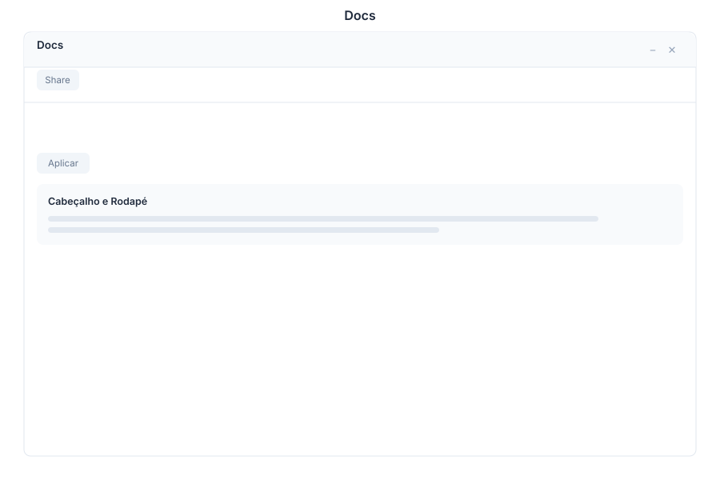

# Docs 🟡 PREVIEW — IN TEST

> **In test.** Docs is a preview application and is **not part of the supported surface**. It is functional and actively being tested, but behaviour and interface may change, and edge cases are not guaranteed. Decide accordingly before depending on it.

Docs is the suite's collaborative document editor: rich text, comments, tracked changes and citation support, with AI assistance.

## What the shipped editor exposes

Verified from the app's own toolbar and module layout (`botui/ui/suite/docs/`).

### Editing

| Capability | Notes |
|---|---|
| Formatting | Rich text with headings, quotes, lists, inline code and links |
| Find & Replace | Search within the document, with regular-expression, formatting and scope options; replace-all is one undoable action |
| Navigation pane | Heading tree with bookmarks and drag-to-reorder, opened from the Navigation pane control |
| Quick parts and autotext | Reusable content blocks with variables and `/shortcut` expansion |
| Language tools | Local-first spelling, style and readability review. Suggestions are accepted individually and reversed with one undo; no document text is sent to a server and AI assistance is off by default |
| Table editing | A contextual Table tools toolbar for insert/delete rows and columns, merge/split cells, header toggle, banding, borders/shading, padding, vertical alignment, width/autofit and column sort; text↔table conversion and `Ctrl+Alt+T` to reopen the tools. Structural edits keep valid table markup and are one undo step. An accessibility check lists missing header scope, uneven column counts and unlabelled tables and jumps to each one |
| Undo / Redo | Standard history |
| **Track Changes** | Record edits as suggestions rather than applying them silently |
| **Compare Documents** | Diff two documents against each other |
| **Version history** | Browse and restore earlier states |
| Activity log | What happened to the document, and when |
| Export | Toolbar Export menu downloads the active document as `.docx`, `.odt`, `.pdf`, `.html`, Markdown or plain text; if the document has no stored copy the editor content is exported instead |

### Structure and content

| Capability | Notes |
|---|---|
| Table of Contents | Generated navigation for the document |
| Header & Footer | Page furniture |
| Insert Table / Image | Structured and visual content |
| Insert Equation | Equation editor opened from the toolbar's equation button: a symbol palette and six templates (fraction, root, integral, sum, matrix, cases) with a LaTeX-style input and live MathML preview. Equations are inserted inline or as display blocks with an accessible description; display equations are numbered per section with right-aligned numbers, and a reference picker inserts cross-references that update on demand. An equation list searches, re-edits, renumbers and deletes equations. LaTeX source is kept as a searchable, re-editable attribute. DOCX OMML round-trip, server persistence and print-quality layout are not implemented |
| Document structure | The toolbar's **Document structure** button opens a dialog with four panels. Numbering applies style-bound multilevel numbers (decimal or legal, with restart-per-higher-level and continue-previous options) as in-document attributes. Captions number figures and tables automatically and regenerate a Table of Figures and Table of Tables in place. Cross-reference fields point to headings, bookmarks, figures and tables and resolve to a number, text or both; a fields panel edits targets and a single Update-all pass refreshes every field. Each edit is one undoable commit that preserves contenteditable markup. Page numbers and leader dots are not produced because the editor has no page model; server-side field resolution and document-schema persistence are not implemented |
| Insert Footnote / Endnote | Scholarly referencing |
| Insert Page Break | Page control |
| From Template | Start from an existing template |

### Collaboration

| Capability | Notes |
|---|---|
| Collaborators & follow | See who is in the document and follow their cursor |
| Comments | Discussions attached to a position in the text |
| Review workflow | The **Review changes** toolbar workspace provides in-context change balloons with author, time and insert/delete/format type. Accept or reject each change independently — neighbouring changes are untouched and the action is individually undoable — or act per author. Five view modes cover all markup, simple markup, no markup, original and final; **Suggestion mode** records edits without applying them and **Protect (comments only)** blocks content edits. Comments are threaded and anchored to a stable id + offset so a mid-paragraph thread survives edits above it; replies, resolve/reopen, @mention chips and open/mine/mentions filters are supported through a focus-trapped composer instead of a native prompt. **Compare documents** builds a redline with per-hunk accept/reject and a merge preview, and a review dashboard summarises author counts, unresolved threads, time in review and sign-off. A permissions matrix previews owner/editor/commenter/viewer capabilities. All review state is document-scoped browser storage labelled "Local only — not saved to the server": server-enforced permissions, mention notifications, co-editing merge and DOCX `w:ins`/`w:del` round-trip are not implemented |
| Presence | Collaborator indicators when a realtime collaboration endpoint is configured; the shipped server exposes REST presence/comments and no `/ws/{app}` collaboration socket, so the editor reports offline instead of retrying a missing route |

### Sharing

The Share control opens the shared access dialog (people grants, public links,
ownership transfer). A **public link** is read-only by design:

| Behaviour | Where it is implemented |
|---|---|
| The dialog mints a token and copies `…/suite/docs/shared.html?link=<token>` | `botui/ui/suite/js/collab-share.js` (`POST /api/collab/links`), `botui/ui/suite/docs/shared.html` |
| Opening the link renders the document in a standalone viewer with **no toolbar and no editor**, marked **Read-only** | `botui/ui/suite/docs/shared-viewer.js` |
| The server resolves the token — never a document id in the URL — and returns the body with `read_only: true` | `GET /api/docs/shared/:token` in `botserver/crates/botdocs/src/shared_link.rs` |
| The link cannot write: every mutating Docs route requires a signed-in `DocUser`, and the token route is declared a capability (read methods only) | `botserver/crates/botsecurity-auth/src/auth_api/public_routes.rs` |
| The Share button shows a dot while a read-only link is active | `botui/ui/suite/docs/modules/15_readonly.js` |

Links can be revoked in the same dialog; expired, revoked and unknown tokens all
answer `404`, so a link never reveals whether a document exists.

### References and AI

| Capability | Notes |
|---|---|
| Citations & References | Source management inside the document |
| AI Assistant | Ask for edits and improvements in natural language. When the deployment has no LLM configured the panel says the document was not changed and points at the matching control — it never returns a fake rewrite, translation or summary. Summarize falls back to an honest excerpt of the selection. |

Localisation ships with `en` and `pt-BR`.

## What changed in this page

Earlier revisions listed a precise feature matrix — font size ranges, alignment options, a fixed set of formatting buttons — presented as finished behaviour. Those specifics could not be verified against the shipped editor, so they have been replaced with the capability list above, which is taken from the actual toolbar and module layout.

## Opening it

Docs is a **preview** application and is additionally gated behind Preview mode as an in-test app. Turn on the **Preview** switch in the left sidebar, then open **Docs** from the app menu.

## When to use something else

| Need | Use |
|---|---|
| A supported rich document, today | [Paper](./paper.md) — also preview, but the simpler authoring surface |
| Tables of data rather than prose | [Sheets](./sheet.md), the most advanced preview app |
| Presentations | [Slides](./slides.md) — also in test |

## See Also

- [Paper](./paper.md) - Notes and documents
- [Slides](./slides.md) - Presentations (in test)
- [Office fidelity contract](./office-fidelity.md) - What a save preserves in DOCX/PPTX/XLSX
- [Explorer](./drive.md) - Where documents are stored
- [Apps overview](./README.md) - Stability classification for the whole suite
