<!-- GENERATED by scripts/gen_source_catalogs.py — do not edit by hand. -->

# Suite App Cards (generated) 🟡 BETA

One card per id in `all_apps()`. Status is `AppStatus` from `registry/ownership.rs` (Supported / Preview / Hidden / Deprecated); launcher visibility comes from the registry constructor. Non-catalog surfaces (vibe toolwindows, admin, biometry, sales, vdi) are not listed.

## About — `about`

**Supported** · system · owned by platform · launcher: Preview

About General Bots: product, version and licensing information.

- Suite route: `/suite/about/about.html`
- Guide: [Guide](../../apps/about.md) · Screen: 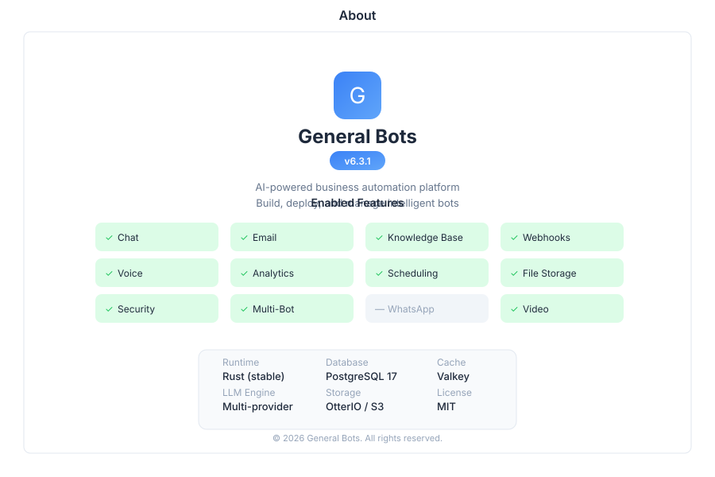

## Analytics — `analytics`

**Preview** · business · owned by business · launcher: Preview

Business analytics dashboards and reports, plus the Operations view with SLO burn, error budgets, traffic, endpoint counters, queue depth, LLM cost and deploy markers.

- Suite route: `/suite/analytics/analytics.html`
- Guide: [Guide](../../apps/analytics.md) · Screen: 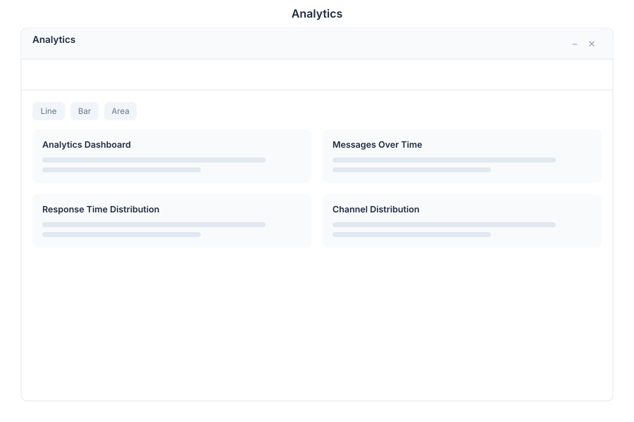

## Approvals — `approvals`

**Preview** · office · owned by office · launcher: Preview

Approval routing, SLA, delegation and e-signature records.

- Suite route: `/suite/approvals/approvals.html`
- Guide: — · Screen: —

## Attendant — `attendant`

**Preview** · business · owned by business · launcher: Preview

Human attendant console with queue and LLM assist.

- Suite route: `/suite/attendant/index.html`
- Guide: [Guide](../../apps/attendant.md) · Screen: 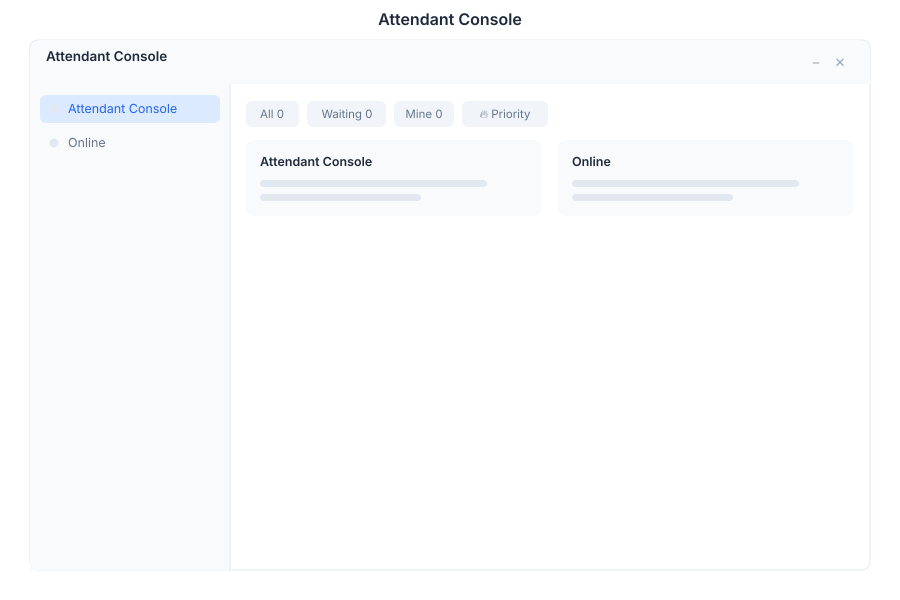

## Automations — `automations`

**Preview** · ai · owned by chat-ai · launcher: Preview

Natural-language scheduled agents with live run dashboard and email/SMS delivery.

- Suite route: `/suite/automations/automations.html`
- Guide: [Guide](../../apps/automations.md) · Screen: 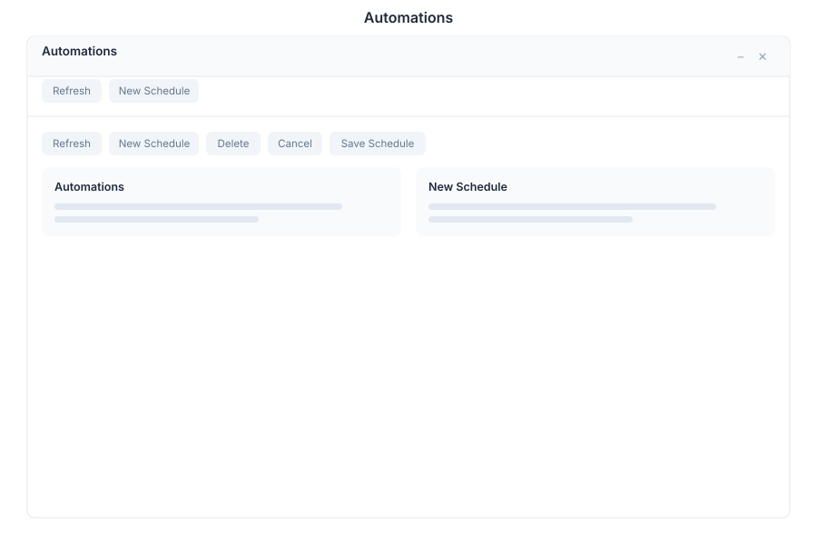

## Banking — `banking`

**Preview** · business · owned by business · launcher: Preview

Banking reconciliation and financial operations.

- Suite route: `/suite/banking/banking.html`
- Guide: [Guide](../../apps/banking.md) · Screen: 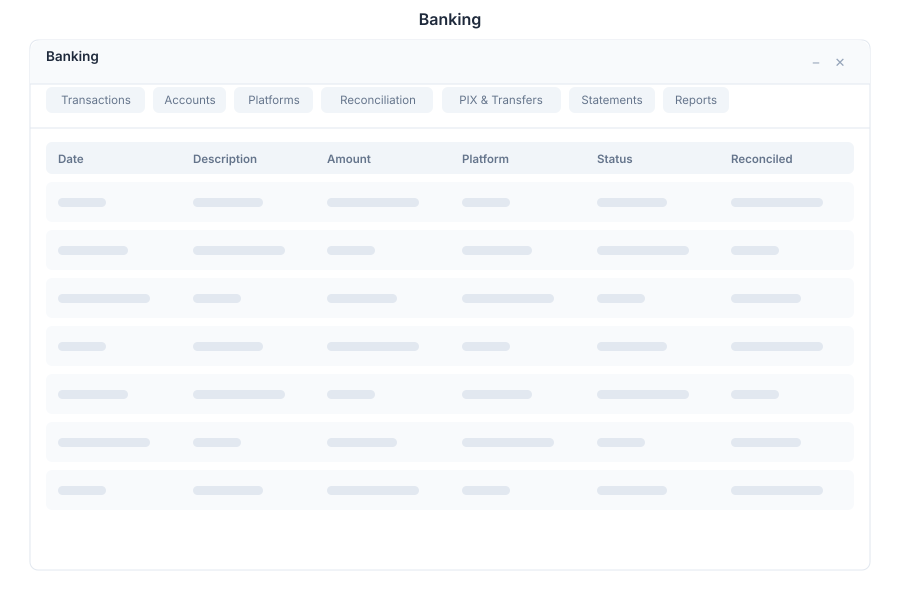

## Billing — `billing`

**Supported** · business · owned by business · launcher: Always

Invoices, quotes, payments and subscriptions.

- Suite route: `/suite/billing/billing.html`
- Guide: [Guide](../../apps/billing.md) · Screen: 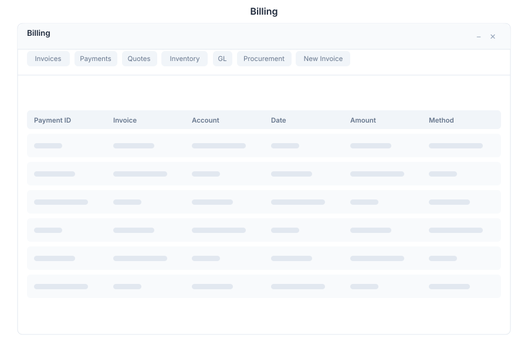

## Browser — `browser`

**Supported** · system · owned by platform · launcher: Always

Embedded web browser with automation.

- Suite route: `/suite/browser/browser.html`
- Guide: [Guide](../../apps/browser.md) · Screen: 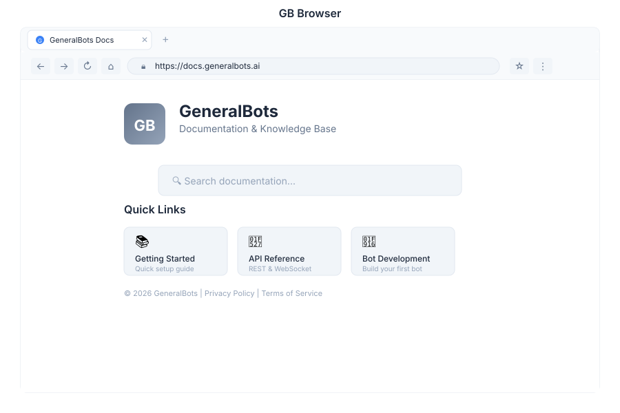

## Calculator — `calculator`

**Supported** · system · owned by desktop · launcher: Always

Basic and scientific calculator with unit conversion and history.

- Suite route: `/suite/calculator/calculator.html`
- Guide: — · Screen: —

## Calendar — `calendar`

**Supported** · office · owned by office · launcher: Always

Calendar and scheduling with conflict detection and invites.

- Suite route: `/suite/calendar/calendar.html`
- Guide: [Guide](../../apps/calendar.md) · Screen: 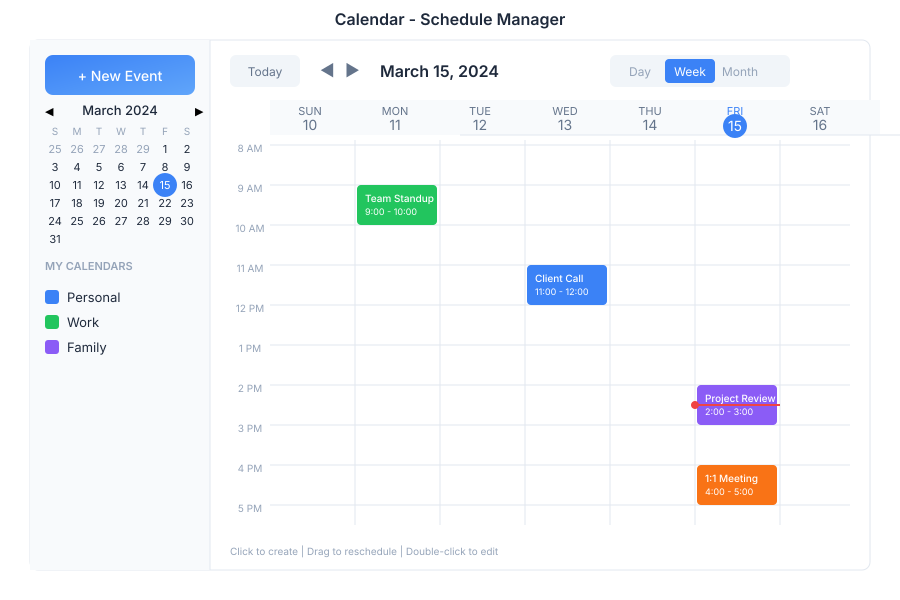

## Campaigns — `campaigns`

**Preview** · business · owned by business · launcher: Preview

Marketing campaigns across channels.

- Suite route: `/suite/campaigns/campaigns.html`
- Guide: [Guide](../../apps/campaigns.md) · Screen: 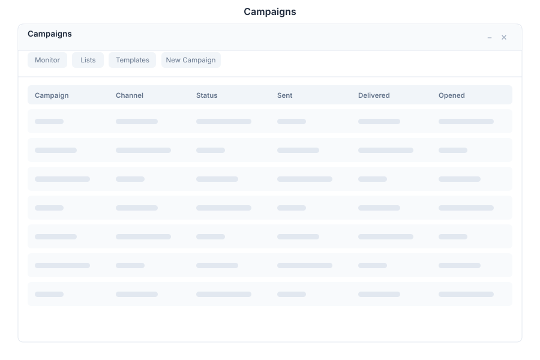

## Canvas — `canvas`

**Preview** · office · owned by office · launcher: Preview

Creative canvas for visuals and whiteboards.

- Suite route: `/suite/canvas/canvas.html`
- Guide: [Guide](../../apps/canvas.md) · Screen: 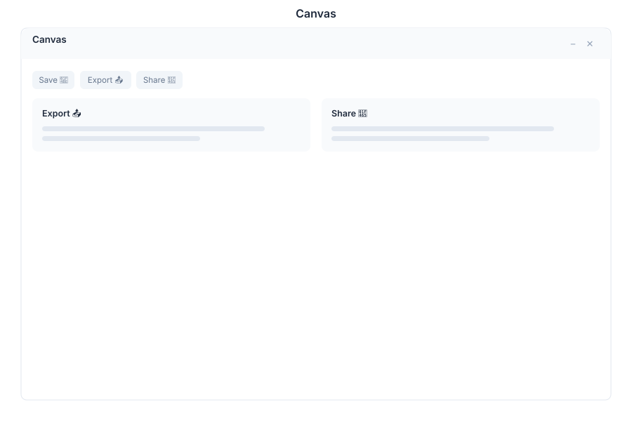

## Chat — `chat`

**Supported** · ai · owned by chat-ai · launcher: Always

Conversational AI assistant with suggestions, tools and memory.

- Suite route: `/suite/partials/chat.html?v=3`
- Guide: [Guide](../../apps/chat.md) · Screen: 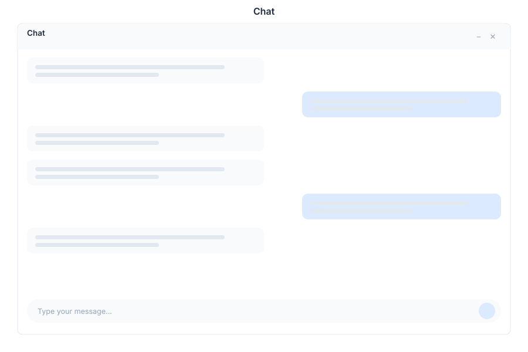

## Clock — `clock`

**Deprecated** · office · owned by desktop · launcher: Preview

Local time and date with timezone-aware display.

- Suite route: `/suite/clock/clock.html`
- Guide: — · Screen: —

## Clock Widget — `clock-widget`

**Supported** · system · owned by desktop · launcher: Always

Desktop clock widget showing local time and date.

- Suite route: `/suite/widgets/clock.html`
- Guide: [Guide](../../apps/clock-widget.md) · Screen: 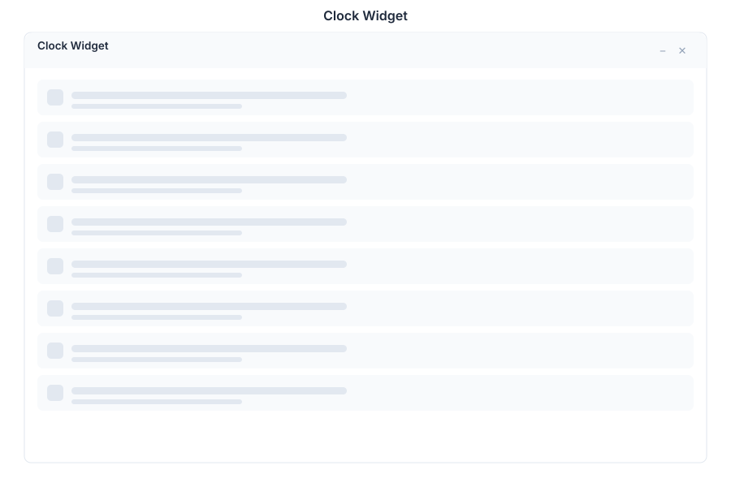

## Compliance — `compliance`

**Preview** · business · owned by business · launcher: Preview

Compliance scanning, audit log and evidence.

- Suite route: `/suite/compliance/compliance.html`
- Guide: [Guide](../../apps/compliance.md) · Screen: 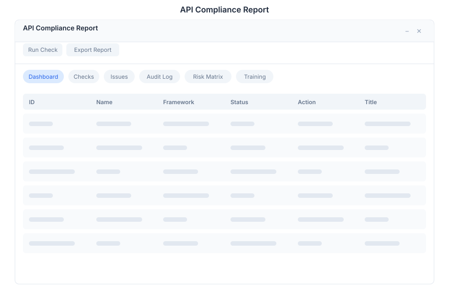

## Concierge — `concierge`

**Preview** · ai · owned by chat-ai · launcher: Preview

AI concierge: natural-language goal execution across every app.

- Suite route: `/suite/concierge/concierge.html`
- Guide: [Guide](../../apps/concierge.md) · Screen: 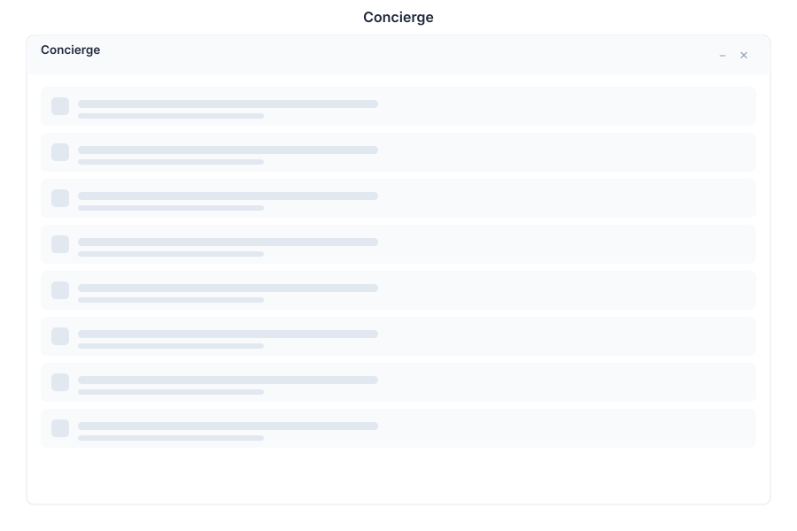

## CRM — `crm`

**Supported** · business · owned by business · launcher: Always

Customer relationship management with pipeline and deals.

- Suite route: `/suite/crm/crm.html`
- Guide: [Guide](../../apps/crm.md) · Screen: 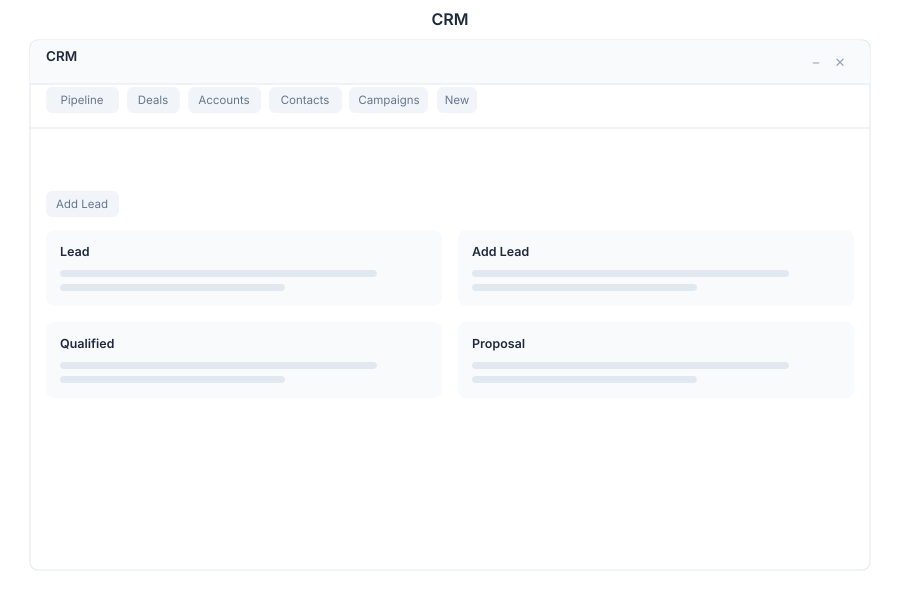

## Database — `database`

**Preview** · dev · owned by platform · launcher: Preview

Visual database explorer with SQL console and CSV import.

- Suite route: `/suite/database/database.html`
- Guide: [Guide](../../apps/database.md) · Screen: 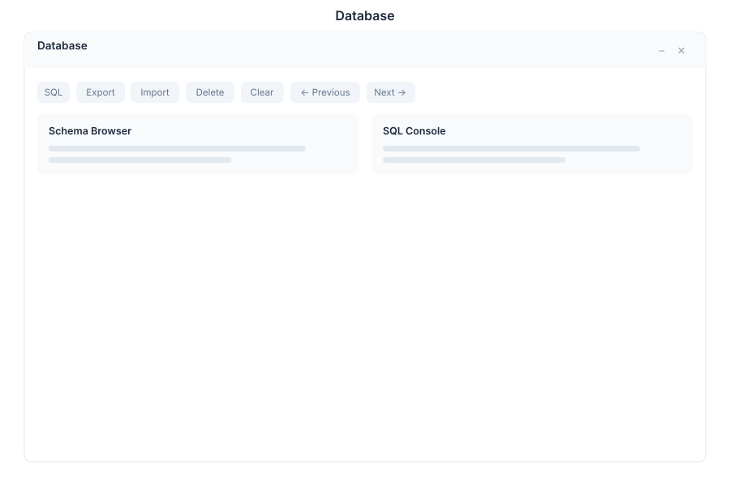

## Designer — `designer`

**Preview** · office · owned by office · launcher: Preview

Low-code app and page designer.

- Suite route: `/suite/designer.html`
- Guide: [Guide](../../apps/designer.md) · Screen: 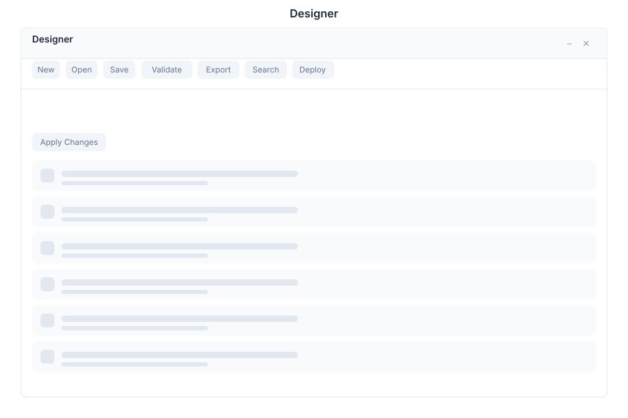

## Desktop — `desktop`

**Preview** · system · owned by platform · launcher: Preview

Virtual desktop infrastructure connection.

- Suite route: `/suite/desktop/vdi.html`
- Guide: [Guide](../../apps/desktop.md) · Screen: 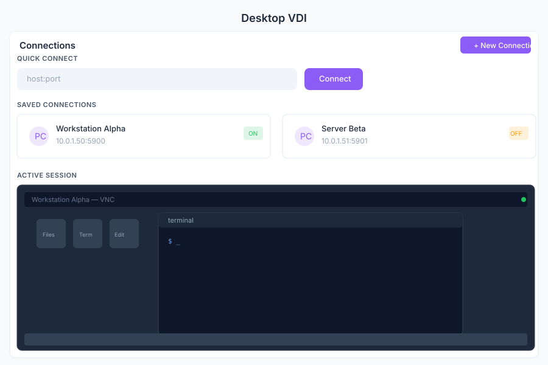

## Docs — `docs`

**Supported** · office · owned by office · launcher: Always

Collaborative document editor with AI assistance.

- Suite route: `/suite/docs/docs.html`
- Guide: [Guide](../../apps/docs.md) · Screen: 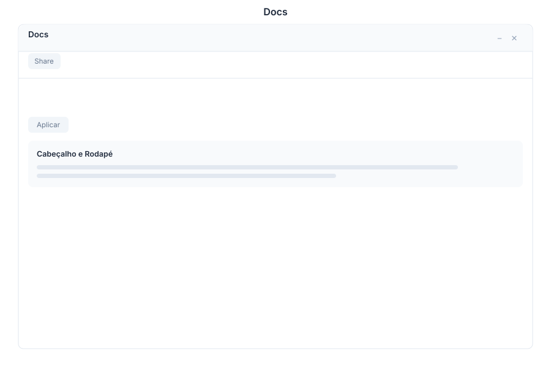

## Explorer — `drive`

**Supported** · system · owned by desktop · launcher: Always

File explorer with Bots, My Files, Shared and Public.

- Suite route: `/suite/drive/drive.html`
- Guide: [Guide](../../apps/drive.md) · Screen: 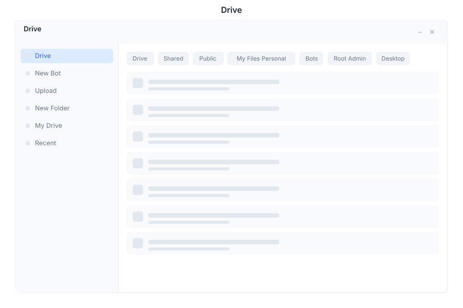

## Editor — `editor`

**Preview** · dev · owned by platform · launcher: Preview

Code and file editor with git integration.

- Suite route: `/suite/editor.html`
- Guide: [Guide](../../apps/editor.md) · Screen: 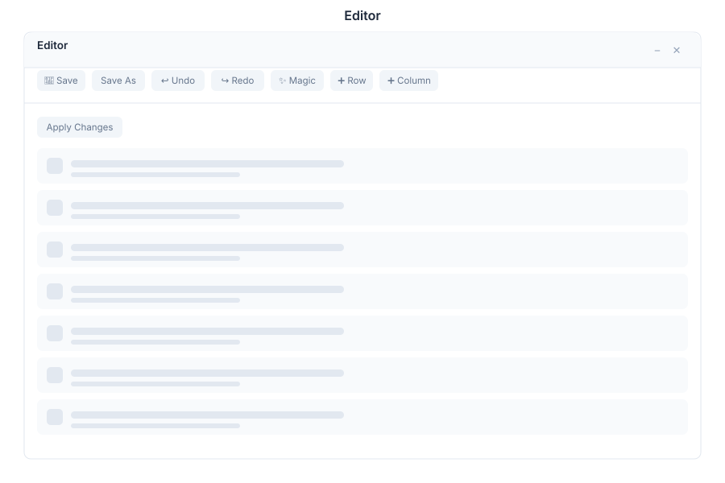

## Events — `events`

**Preview** · business · owned by office · launcher: Always

Schedule and review events, appointments and reminders.

- Suite route: `/suite/events/events.html`
- Guide: — · Screen: —

## Anti-Fraud — `fraud`

**Preview** · business · owned by business · launcher: Preview

Fraud detection and governance.

- Suite route: `/suite/fraud/fraud.html`
- Guide: [Guide](../../apps/fraud.md) · Screen: 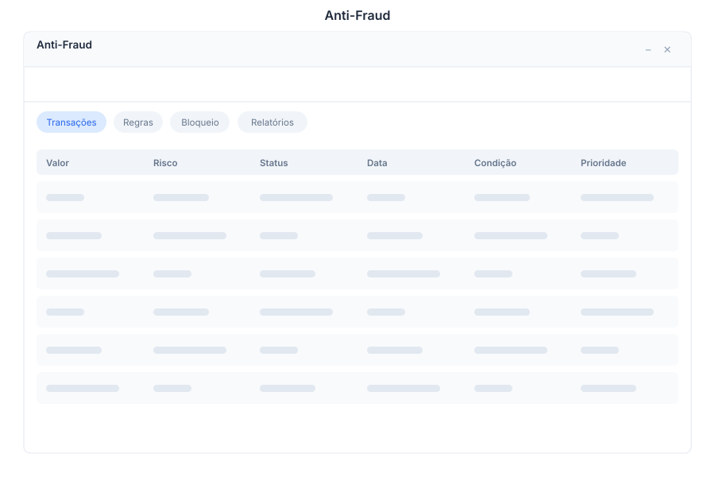

## Goals — `goals`

**Preview** · office · owned by office · launcher: Preview

Objective and key results tracking with AI suggestions.

- Suite route: `/suite/goals/goals.html`
- Guide: [Guide](../../apps/goals.md) · Screen: 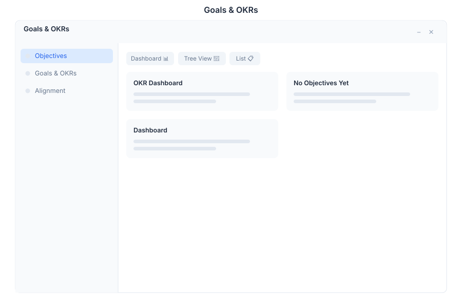

## Handoff — `handoff`

**Preview** · business · owned by business · launcher: Preview

Human handoff and escalation workflows.

- Suite route: `/suite/handoff/handoff.html`
- Guide: [Guide](../../apps/handoff.md) · Screen: 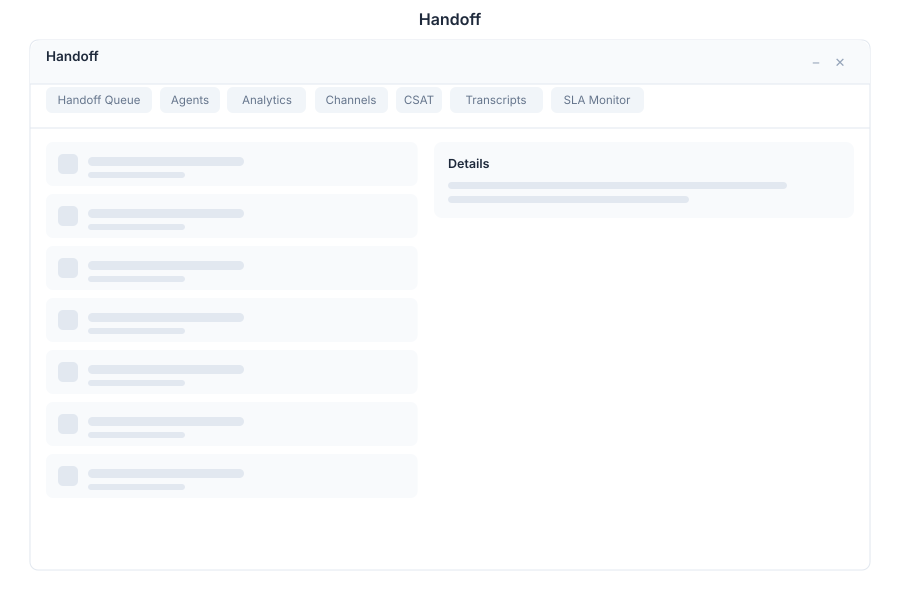

## HR — `hr`

**Preview** · business · owned by business · launcher: Preview

Human resources: employees, onboarding and requests.

- Suite route: `/suite/hr/hr.html`
- Guide: [Guide](../../apps/hr.md) · Screen: 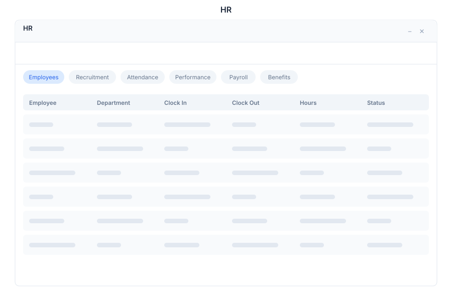

## Integrations — `integrations`

**Supported** · dev · owned by platform · launcher: Always

Configure provider connections, repositories, models, MCP servers and LLM action verbs.

- Suite route: `/suite/integrations/integrations.html`
- Guide: [Guide](../../apps/integrations.md) · Screen: 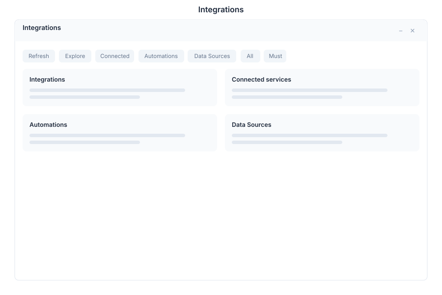

## JukeBox — `jukebox`

**Supported** · ai · owned by desktop · launcher: Always

Create complete songs, instrumentals and vocal variations with ACE-Step.

- Suite route: `/suite/jukebox/jukebox.html`
- Guide: [Guide](../../apps/jukebox.md) · Screen: 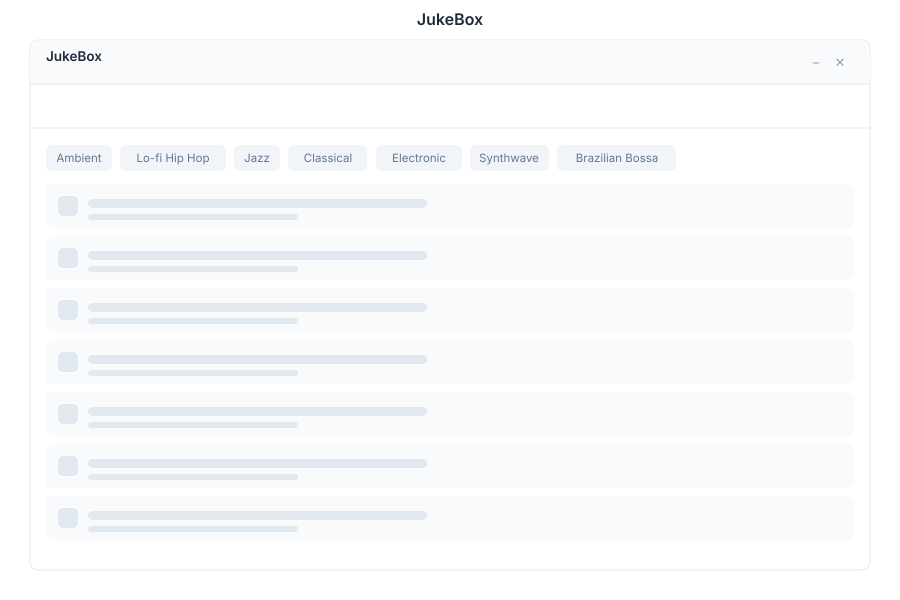

## KYC — `kyc`

**Preview** · business · owned by business · launcher: Preview

Know your customer verification workflows.

- Suite route: `/suite/kyc/kyc.html`
- Guide: [Guide](../../apps/kyc.md) · Screen: 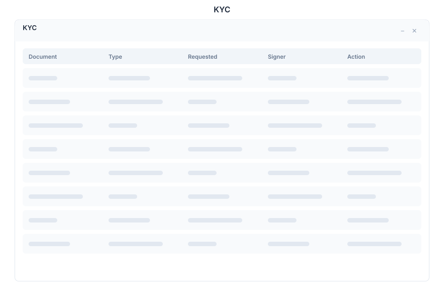

## Learn — `learn`

**Preview** · ai · owned by chat-ai · launcher: Preview

Personalized learning platform with courses and assessments.

- Suite route: `/suite/learn/learn-app.html`
- Guide: [Guide](../../apps/learn.md) · Screen: 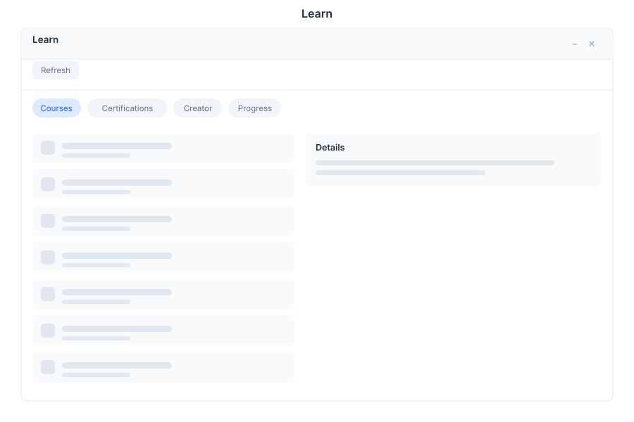

## Lists — `lists`

**Preview** · business · owned by business · launcher: Preview

Structured lists and data collections.

- Suite route: `/suite/lists/lists.html`
- Guide: [Guide](../../apps/lists.md) · Screen: 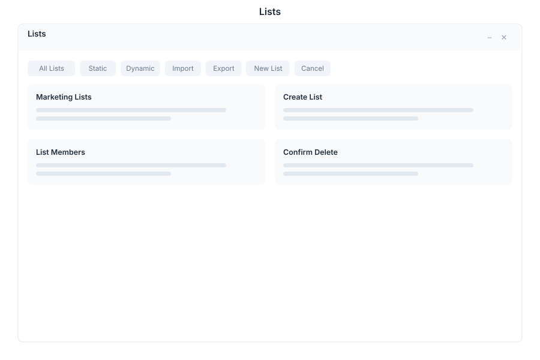

## Mail — `mail`

**Supported** · office · owned by office · launcher: Always

Unified email client with AI replies, rules and signatures.

- Suite route: `/suite/mail/mail.html`
- Guide: [Guide](../../apps/mail.md) · Screen: 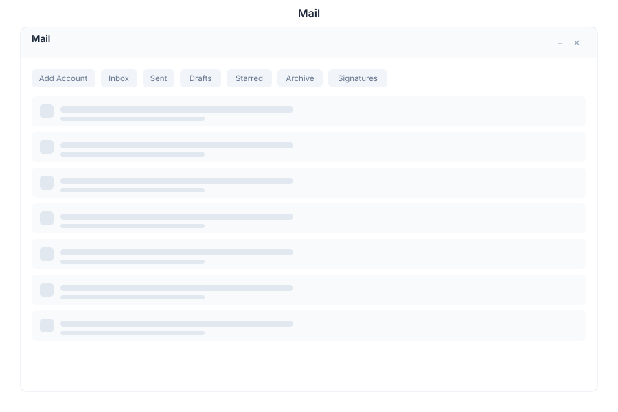

## Meet — `meet`

**Preview** · office · owned by office · launcher: Preview

Video meetings with screen sharing and collaborative whiteboards.

- Suite route: `/suite/meet/meet.html`
- Guide: [Guide](../../apps/meet.md) · Screen: 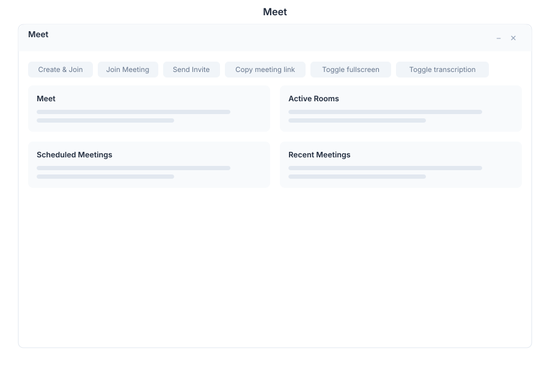

## Memory — `memory`

**Preview** · system · owned by chat-ai · launcher: Preview

View, edit and export the personal memory profile your assistant learns from.

- Suite route: `/suite/memory/memory.html`
- Guide: [Guide](../../apps/memory.md) · Screen: 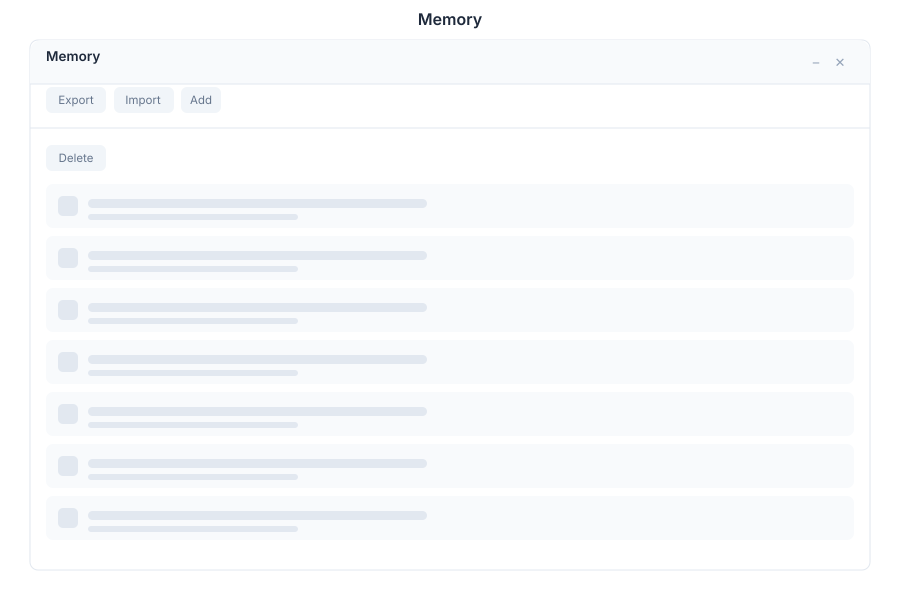

## Minutes — `minutes`

**Preview** · office · owned by office · launcher: Preview

Meeting minutes with action items and summaries.

- Suite route: `/suite/minutes/minutes.html`
- Guide: [Guide](../../apps/minutes.md) · Screen: 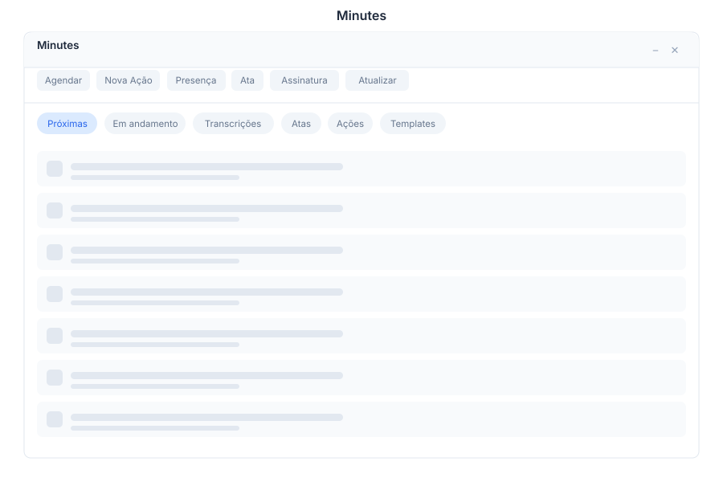

## Monitoring — `monitoring`

**Preview** · system · owned by platform · launcher: Preview

System monitoring: health, resources, alerts and logs.

- Suite route: `/suite/monitoring/monitoring.html`
- Guide: [Guide](../../apps/monitoring.md) · Screen: 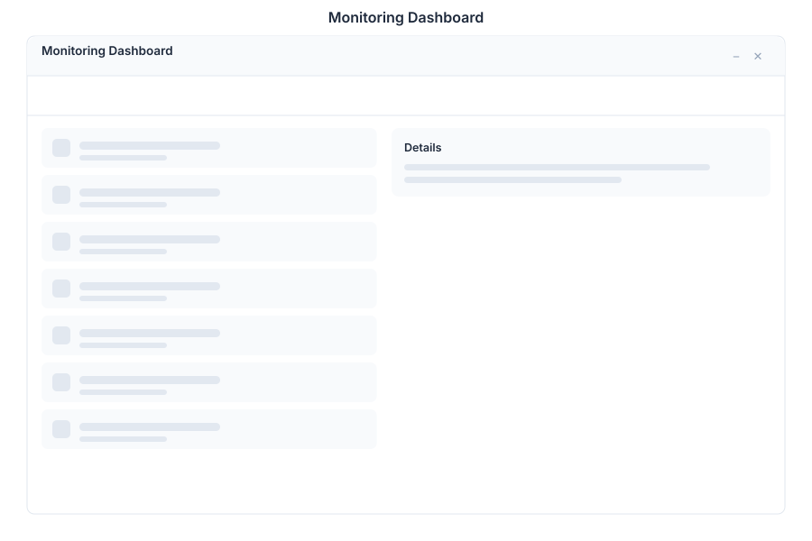

## Notepad — `notepad`

**Supported** · office · owned by office · launcher: Always

Plain text editor with a single textarea; saves locally. Use field 'text' for the whole note.

- Suite route: `/suite/notepad/notepad.html`
- Guide: — · Screen: —

## Sticky Notes — `notes`

**Supported** · office · owned by desktop · launcher: Always

Colorful sticky notes that persist on the desktop.

- Suite route: `/suite/notes/notes.html`
- Guide: [Guide](../../apps/notes.md) · Screen: 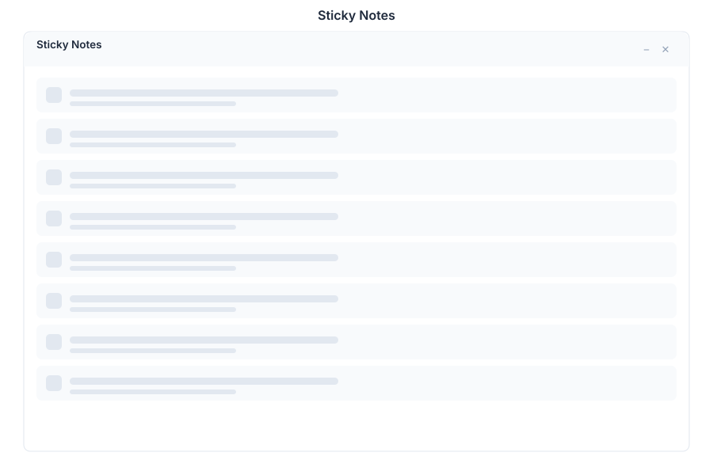

## o365 — `o365`

**Preview** · office · owned by office · launcher: Preview

Unified office productivity integration: SP, Calendar, Drive and mail.

- Suite route: `/suite/o365/o365.html`
- Guide: [Guide](../../apps/o365.md) · Screen: 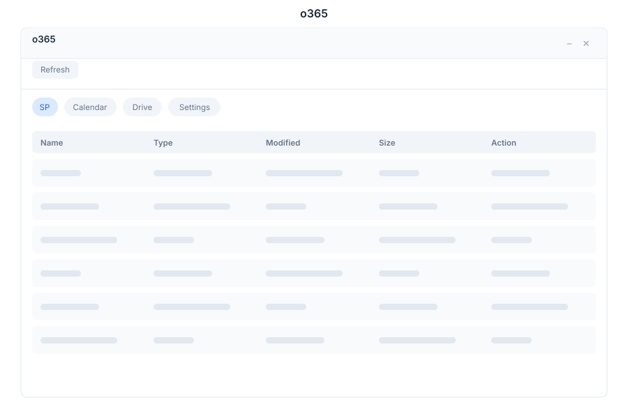

## Paper — `paper`

**Supported** · office · owned by office · launcher: Always

Rich notes and documents with AI writing assistance.

- Suite route: `/suite/paper/paper.html`
- Guide: [Guide](../../apps/paper.md) · Screen: 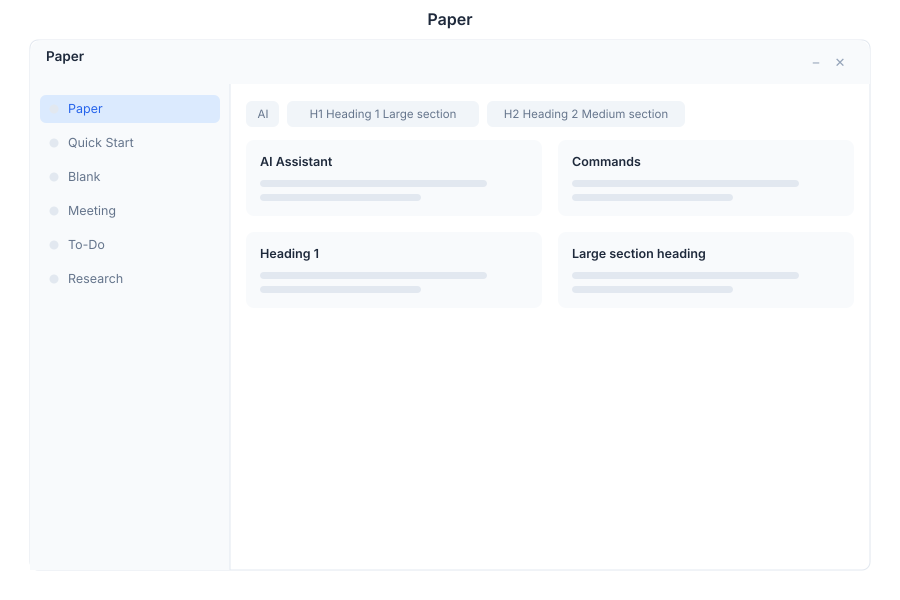

## People — `people`

**Preview** · business · owned by business · launcher: Preview

Contact and lead management.

- Suite route: `/suite/people/people.html`
- Guide: [Guide](../../apps/people.md) · Screen: 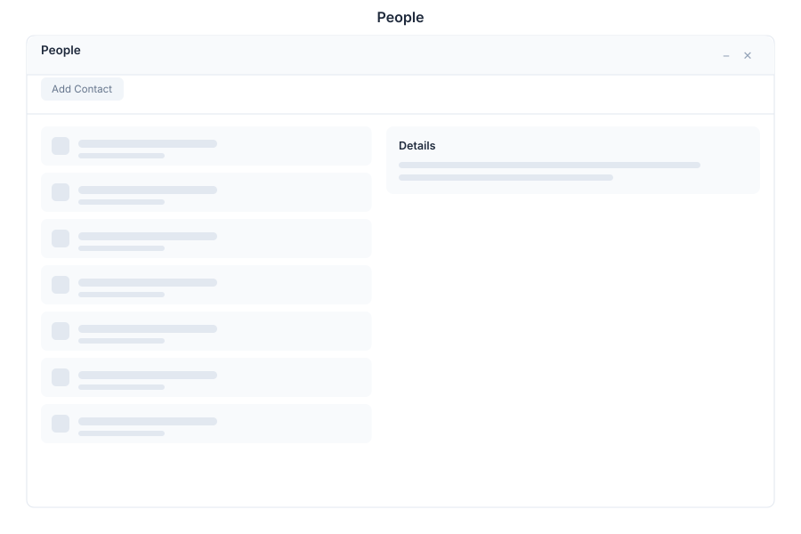

## Photos — `photos`

**Supported** · system · owned by desktop · launcher: Always

Photo gallery from Drive with lightbox viewing.

- Suite route: `/suite/photos/photos.html`
- Guide: [Guide](../../apps/photos.md) · Screen: 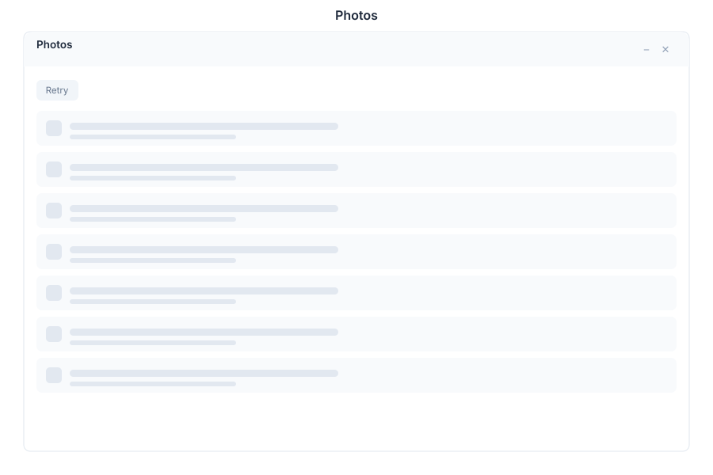

## Plan — `plan`

**Preview** · office · owned by office · launcher: Preview

Strategic planning with OKRs and roadmap boards.

- Suite route: `/suite/plan/plan.html`
- Guide: [Guide](../../apps/plan.md) · Screen: 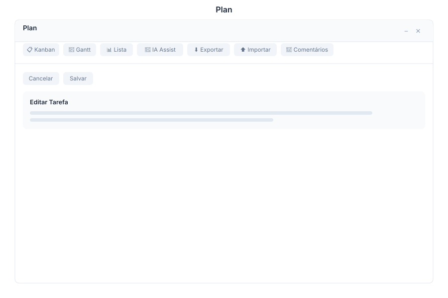

## Player — `player`

**Supported** · system · owned by desktop · launcher: Always

Media player for the suite.

- Suite route: `/suite/player/player.html`
- Guide: [Guide](../../apps/player.md) · Screen: 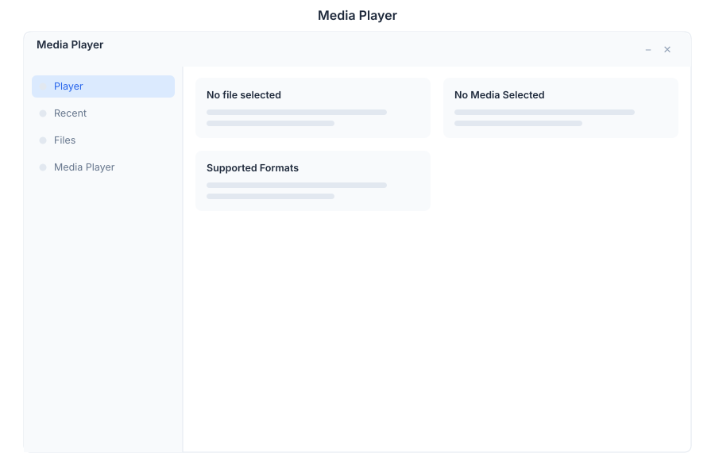

## Plugins — `plugins`

**Preview** · dev · owned by platform · launcher: Preview

Plugin manager: install, enable and configure suite plugin modules.

- Suite route: `/suite/plugins/plugins.html`
- Guide: — · Screen: —

## POS — `pos`

**Preview** · business · owned by business · launcher: Preview

Point of sale with orders and products.

- Suite route: `/suite/pos/pos.html`
- Guide: [Guide](../../apps/pos.md) · Screen: 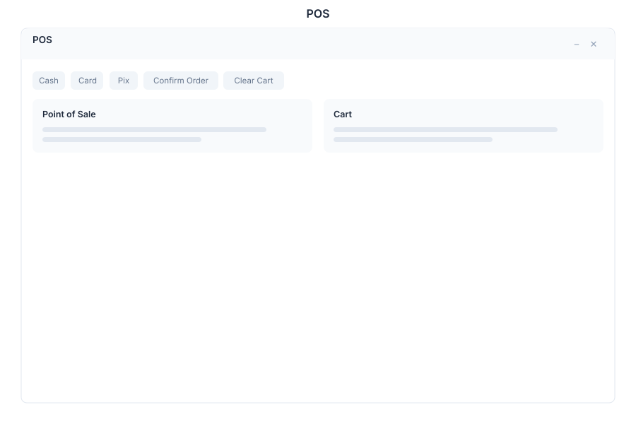

## Preview — `preview`

**Supported** · office · owned by office · launcher: Always

Renders the last generated file or document (finalize-only).

- Suite route: `/suite/partials/preview.html`
- Guide: — · Screen: —

## Products — `products`

**Supported** · business · owned by business · launcher: Always

Product catalog with items, services and price lists.

- Suite route: `/suite/products/products.html`
- Guide: [Guide](../../apps/products.md) · Screen: 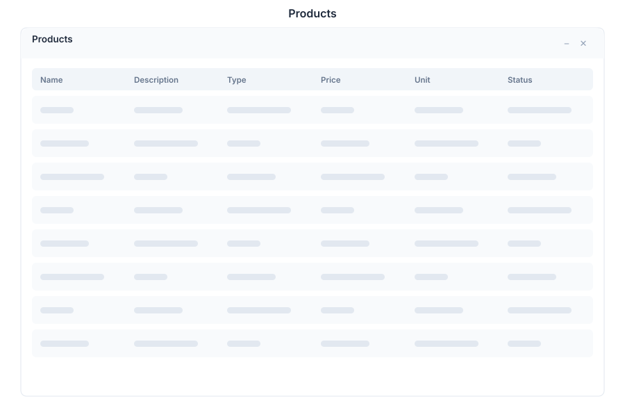

## Project — `project`

**Preview** · business · owned by office · launcher: Preview

Project planning with phases and deliverables.

- Suite route: `/suite/project/project.html`
- Guide: [Guide](../../apps/project.md) · Screen: 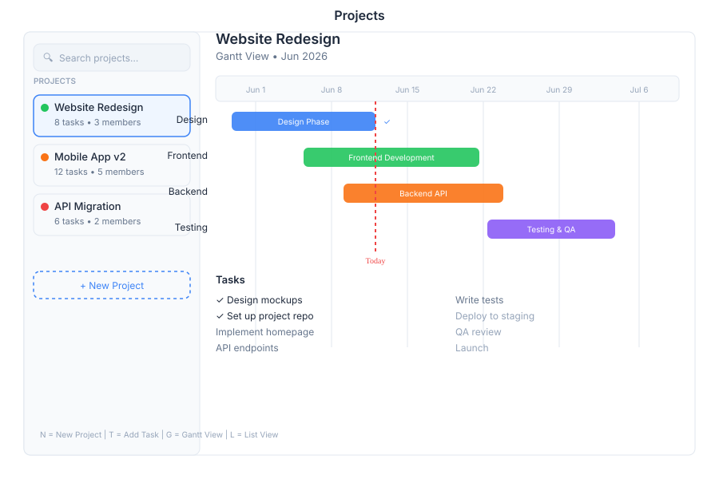

## Recycle Bin — `recycle`

**Preview** · system · owned by desktop · launcher: Preview

Restore or permanently delete trashed files from Drive.

- Suite route: `/suite/recycle/recycle.html`
- Guide: [Guide](../../apps/recycle.md) · Screen: 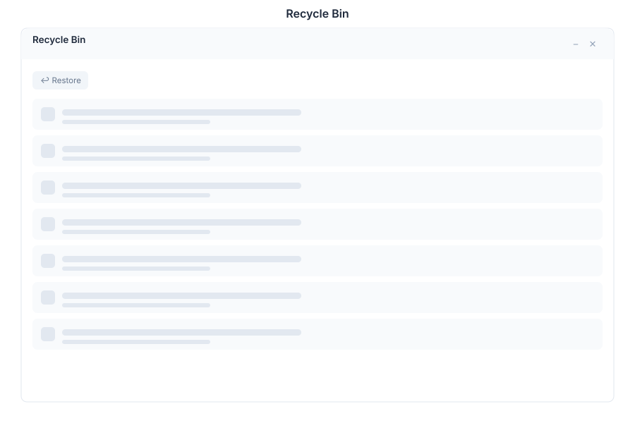

## Research — `research`

**Hidden** · ai · owned by chat-ai · launcher: Preview

AI-powered search and discovery across web, docs and knowledge bases.

- Suite route: `/suite/research/research.html`
- Guide: [Guide](../../apps/research.md) · Screen: 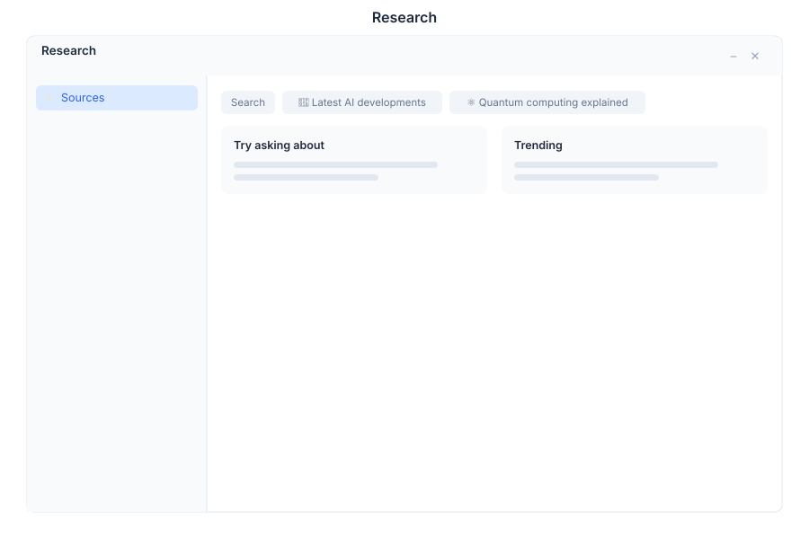

## Retail — `retail`

**Preview** · business · owned by business · launcher: Preview

Retail operations and inventory.

- Suite route: `/suite/retail/retail.html`
- Guide: [Guide](../../apps/retail.md) · Screen: 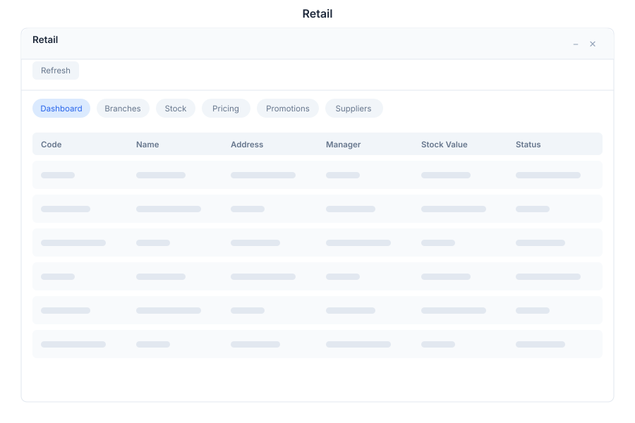

## Settings — `settings`

**Supported** · system · owned by platform · launcher: Always

Unified Settings: profile, appearance, wallpaper, language, security and admin sections (RBAC-gated).

- Suite route: `/suite/settings/index.html`
- Guide: [Guide](../../apps/settings.md) · Screen: 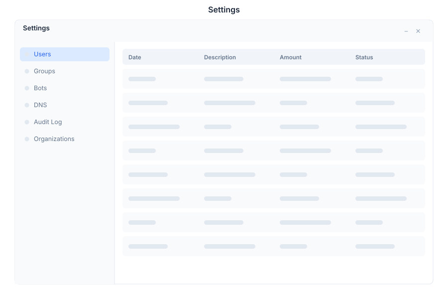

## Sheets — `sheet`

**Supported** · office · owned by office · launcher: Always

Spreadsheets with formulas, charts, filtering, sorting, merge, freeze panes, validation and CSV/XLSX import/export. When the user asks for a chart, create it with sheet.chart.create — never ask the user to insert one by hand.

- Suite route: `/suite/sheet/sheet.html`
- Guide: [Guide](../../apps/sheet.md) · Screen: 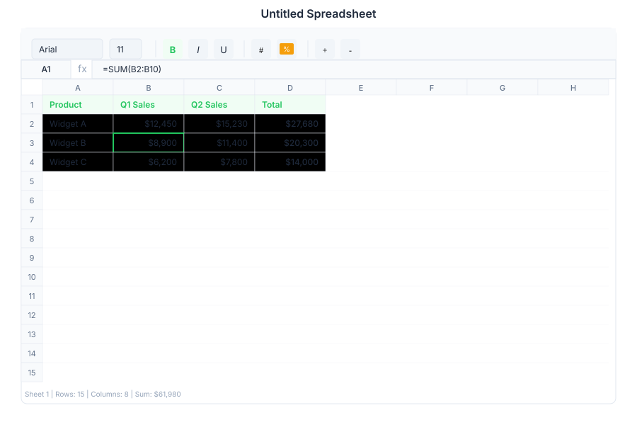

## Slides — `slides`

**Supported** · office · owned by office · launcher: Always

Presentation builder with themes and collaboration.

- Suite route: `/suite/slides/slides.html`
- Guide: [Guide](../../apps/slides.md) · Screen: 

## Social — `social`

**Preview** · business · owned by business · launcher: Preview

Social media posting and feed management.

- Suite route: `/suite/social/social.html`
- Guide: [Guide](../../apps/social.md) · Screen: 

## App Store — `store`

**Preview** · system · owned by desktop · launcher: Preview

Browse, install and manage applications for the desktop.

- Suite route: `/suite/store/store.html`
- Guide: [Guide](../../apps/store.md) · Screen: 

## Tasks — `tasks`

**Supported** · office · owned by office · launcher: Always

Task management with AI autotask execution.

- Suite route: `/suite/tasks/tasks.html`
- Guide: [Guide](../../apps/tasks.md) · Screen: 

## Tax — `tax`

**Preview** · business · owned by business · launcher: Preview

Brazilian tax documents: NF-e, NFS-e and CT-e.

- Suite route: `/suite/tax/tax.html`
- Guide: [Guide](../../apps/tax.md) · Screen: 

## Message Templates — `templates`

**Preview** · office · owned by office · launcher: Preview

Channel message templates for email, WhatsApp, social, bot and notifications.

- Suite route: `/suite/templates/templates.html`
- Guide: [Guide](../../apps/templates.md) · Screen: 

## Terminal — `terminal`

**Preview** · dev · owned by platform · launcher: Preview

Shell inside your workspace VM, next to the conversation files.

- Suite route: `/suite/partials/terminal.html`
- Guide: [Guide](../../apps/terminal.md) · Screen: 

## Tickets — `tickets`

**Preview** · business · owned by business · launcher: Preview

Support tickets with AI triage and resolution.

- Suite route: `/suite/tickets/tickets.html`
- Guide: [Guide](../../apps/tickets.md) · Screen: 

## Time Clock — `timeclock`

**Preview** · office · owned by office · launcher: Preview

Time tracking and attendance with overtime forms.

- Suite route: `/suite/timeclock/timeclock.html`
- Guide: [Guide](../../apps/timeclock.md) · Screen: 

## Timer — `timer`

**Supported** · office · owned by desktop · launcher: Always

Pomodoro and countdown timer with notifications.

- Suite route: `/suite/timer/timer.html`
- Guide: [Guide](../../apps/timer.md) · Screen: 

## Vibe — `vibe`

**Preview** · ai · owned by chat-ai · launcher: Preview

Generative agentic workspace for building and running assistants.

- Suite route: `/suite/partials/vibe.html`
- Guide: [Guide](../../apps/vibe.md) · Screen: 

## Video AI — `video`

**Preview** · ai · owned by chat-ai · launcher: Preview

AI video editing, analytics and generation.

- Suite route: `/suite/video/video.html`
- Guide: [Guide](../../apps/video.md) · Screen: 

## Vision — `vision`

**Preview** · ai · owned by chat-ai · launcher: Preview

Computer vision: image analysis, QR codes and video description.

- Suite route: `/suite/vision/vision.html`
- Guide: [Guide](../../apps/vision.md) · Screen: 

## Weather — `weather`

**Supported** · system · owned by desktop · launcher: Always

Current conditions and forecast for any city.

- Suite route: `/suite/weather/weather.html`
- Guide: [Guide](../../apps/weather.md) · Screen: 

## Workspace — `workspace`

**Preview** · system · owned by office · launcher: Preview

Collaborative workspace with pages and search.

- Suite route: `/suite/workspace/workspace.html`
- Guide: [Guide](../../apps/workspace.md) · Screen: 

