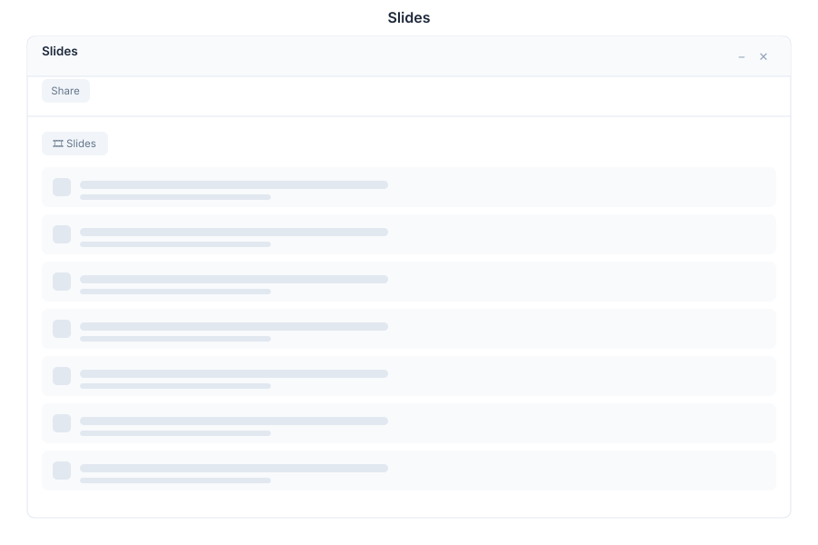

# Slides 🟡 PREVIEW — IN TEST

> **In test.** Slides is a preview application and is **not part of the supported surface**. It is functional and actively being tested, but behaviour and interface may change, and edge cases are not guaranteed. Do not commit a live presentation to it without a rehearsal.

Slides is the suite's presentation editor: a canvas of slides with shape and media tools, a presenter mode with audience engagement, and version history.

## What the shipped editor exposes

Verified from the app's own toolbar and module layout (`botui/ui/suite/slides/`).

### Building slides

| Capability | Notes |
|---|---|
| New Slide | Add a slide to the deck |
| Masters and brand kit | A local **masters** workspace adds a three-level cascade (master → layout → slide) with an effective-style inspector that shows which level each value inherits from or overrides. Theme tokens (dk1/lt1/dk2/lt2, accent1–6, major/minor fonts, effects) are referenced by default; a layout editor creates, renames and duplicates layouts with nine placeholder roles, per-layout geometry, background, footer and number. A theme or layout can be applied to a selection or all slides while preserving explicit overrides, with a before/after affected-slide preview — changing a master token updates only non-overriding slides. A brand kit holds approved fonts, palette and logo with a warn/block lock against off-brand content, plus a local versioned template library. All data is deck-scoped browser storage labelled "Local only — not saved to the server": real PPTX slideMaster/slideLayout/theme parts, PPTX import and server persistence are not implemented |
| Master Slide | Define the shared layout slides inherit from |
| Add Text / Image | Text boxes and pictures |
| Add Shape | Includes rectangle, circle and triangle insert tools |
| Add Table / Add Chart | Tabular and data visualisation content |
| Rotation | Rotate elements by degrees, with a reset |
| Theme / Background / Transition / Animation | Presentation styling |
| Notes | Speaker notes per slide |
| Duplicate / Delete | Buttons on each thumbnail in the slide rail |
| Reorder slides | Toolbar sorter: drag or use ↑/↓, then Save writes the deck order |
| Insert hub | Searchable insert dialog with live preview and Drive media, opened from the Insert button |
| Animation timeline | Per-slide effect list with entrance, emphasis and exit effects, motion paths, paragraph builds, start triggers and a build scrubber. Reduced motion — from the OS setting or the deck flag — shows final states immediately, and a failed effect never blocks advancing |
| Transitions gallery | Duration, direction, easing and advance settings, with apply-to-all and per-slide overrides. Authored animation data is kept locally; no server persistence endpoint exists yet |
| Review menu | Outline view (editable title/bullet hierarchy with promote/demote, drag and keyboard reorder, paste-bullets from Word), deck-wide find/replace across text, tables, charts and notes with per-match review and undoable replace-all, sections, bulk slide actions, a notes workspace, an accessibility panel for missing alt text and a deck-properties dialog. All review metadata is labelled local-only and stored in the browser; no server persistence exists yet |
| Diagram editor | The **Diagrams** toolbar button opens a local-only editor with six auto-layout presets (process, cycle, hierarchy, org chart, matrix, pyramid, list) whose nodes reflow on add, remove, promote and demote; a flowchart mode with shape ports and orthogonal connectors that follow node moves; a local CSV/paste org chart from name/title/reports-to rows with cycle-safe hierarchy; and 16 searchable vendored SVG icons. Diagrams live in a deck-scoped browser layer that never writes slide elements or the server. PPTX native shape/connector export and a guide/snap system are not implemented |
| Table and media editing | A toolbar button opens local authoring for tables and media. Tables can be edited on the canvas — cell text, row/column insert and delete, merge/split, a header row, banded rows, borders, padding, alignment and column widths — with each edit kept as one undoable step and the table markup left valid. A media browser inserts images, video and audio from Drive, upload or URL with a thumbnail and duration, and media controls cover trim start/end, poster frame, autoplay/loop/mute and volume with a present-mode preview. WebVTT captions, a transcript panel and caption styling are supported, and an accessible-export check flags media missing captions or alt text. Alt text is required for posters and autoplay-with-sound is off by default. Structured tables and caption/poster/alt metadata are labelled "Local only — not saved to the server" and kept in deck-scoped browser storage: the server cannot round-trip them, and native PPTX `a:tbl` and media-relationship export are not implemented |
| Object model | The **Objects** toolbar button opens a local canvas layer with shift-click and rubber-band multi-select, keyboard nudge, select-all and a selection-aware toolbar. Nested group/ungroup, z-order, lock and hide are each one undoable step; align/distribute/space-evenly works with smart guides, a grid, rulers and snapping toggles. Connectors stay attached when either endpoint moves, and a freeform pen, line/arrow styles, reversible non-destructive crop and mask-to-shape, replace image, hyperlink and alt-text/decorative marking are available. Undo/redo covers multi-object operations, and slide-size presets (16:9, 4:3, A4, custom) proportionally rescale positions with a warning before committing. Objects live in a deck-scoped browser layer labelled "Local only — not saved to the server": the server-persisting slide element flow is untouched, and PPTX round-trip is not implemented |
| Audience and analytics | A local **Audience and analytics** workspace adds share-link engagement and audience interaction. Analytics computed from a deterministic viewer-event fixture show views, unique viewers, first/last view, per-slide dwell and drop-off, completion rate and privacy-safe device/region buckets, with CSV export. Audience Q&A supports submit, upvote, an approve/reject moderation queue and an answered archive under an attributable-or-anonymous policy. Polls move through draft/live/closed with simulated live results and response export. Follow-along tracks the presenter's slide with a reconnect simulation, and a console panel shows elapsed time, question count, poll status and devices together. A retention/anonymisation option strips personal data from exports. All data is deck-scoped browser storage under `gb-slides-analytics:<deckId>` and labelled "Local only — not saved to the server": real telemetry, live transport, multi-device sync and server persistence are not implemented |
| Delivery tools | A local delivery workspace adds a presenter console (current/next slide previews, elapsed timer, speaker notes and a "no audience window connected" indicator), named custom shows with an explicit play order and return-to-deck, sections with jump navigation, a captions on/off toggle with a style preview, rehearsal mode with per-slide targets and an over/under summary, 1/2/4/6-per-page handout previews, and a local recording indicator with a live clock that resumes on reload. All data is deck-scoped browser storage and explicitly local-only: no real media capture, audience or second-display sync, speech recognition, PDF/PPTX export or server persistence is implemented |

### Presenting

| Capability | Notes |
|---|---|
| Present / stop presenting | Enter and leave presentation mode |
| **Presenter View** | The presenter's own screen, showing what the audience does not see |
| **Laser pointer** | Point at content without changing it |
| Export | Toolbar Export menu: PPTX, ODP (complete ODF package), HTML, SVG (first slide), Markdown and JSON |

### Audience engagement

| Capability | Notes |
|---|---|
| **Questions & answers** | Attendees ask questions; the presenter marks them answered or reopens them |
| Comments | Annotations attached to an element on a slide |
| Collaborators & follow | Who is in the deck, and following their position |
| Activity log / Version history | What changed, and the ability to go back |

## What changed in this page

Earlier revisions listed a precise feature matrix — named themes such as *Professional*, *Creative*, *Academic*, a fixed transition list, and "upload your own template" — presented as finished behaviour. Those specifics could not be verified against the shipped editor, so they have been replaced with the capability list above, which is taken from the actual toolbar and module layout.

## Opening it

Slides is a **preview** application and is additionally gated behind Preview mode as an in-test app. Turn on the **Preview** switch in the left sidebar, then open **Slides** from the app menu.

## A caution for real use

Presenting from an in-test editor carries a specific kind of risk: the failure is public. If the deck matters, rehearse it in the room and have an export as a fallback. [Export](#presenting) exists for exactly this reason.

## See Also

- [Docs](./docs.md) - Documents (in test)
- [Sheets](./sheet.md) - Spreadsheets, the most advanced preview app
- [Office fidelity contract](./office-fidelity.md) - What a save preserves in DOCX/PPTX/XLSX
- [Meet](./meet.md) - Running the meeting around the presentation
- [Apps overview](./README.md) - Stability classification for the whole suite
