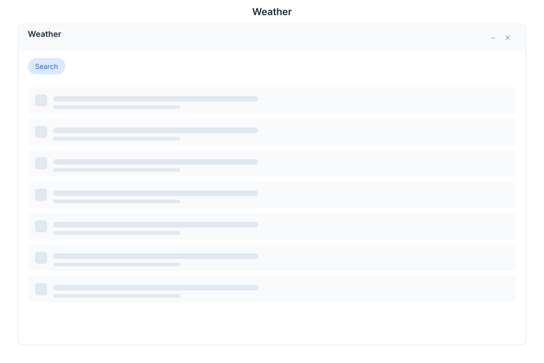

# Weather 🟢 GA

> **Enabled by the default product profile.** Add `weather` to the `apps=` line of a custom `.product` file to keep it, or remove it to hide the app.

Weather shows current conditions for a city you search for, or for your own location.

## What it does

| Capability | Detail |
|---|---|
| **Search by city** | Type a city name to see its conditions |
| **Current conditions** | Temperature and conditions for the selected place |
| **My location** | Use the browser's location instead of typing a city |

## Why it is in a business suite

Weather is context, not decoration. Schedule changes, site visits, travel and delivery planning all depend on it, and having it inside the same desktop as the calendar and the tasks avoids switching to another device for a one-line answer.

An assistant can also answer weather questions directly in [Chat](./chat.md) without opening this app.

## Opening it

Open **Weather** from the app menu or the Start menu. The app is part of the
default product profile (`apps=…,weather`); removing it from `.product` hides
the launcher tile and also removes it from the assistant's UI-plan catalog.

## Data path

The app calls `GET /api/weather?city=…` (or `?lat=…&lon=…`) on the botserver.
The server geocodes the city and fetches the seven-day forecast from
Open-Meteo, returning the payload to the browser. Proxying keeps the app
working on dual-stack networks where the browser picks an unreachable IPv6
geocoding host, and avoids any CORS dependency in the UI. If the proxy is
unavailable, the app falls back to calling Open-Meteo directly.

## Limits

- "My location" depends on the browser granting location permission.
- Conditions come from an external provider, so it requires outbound network access from the server.

## See Also

- [Channels](../../06-channels/channels.md) - Asking the bot for an answer instead
- [Calendar](./calendar.md) - Planning around the forecast
- [Apps overview](./README.md) - Stability classification for the whole suite
