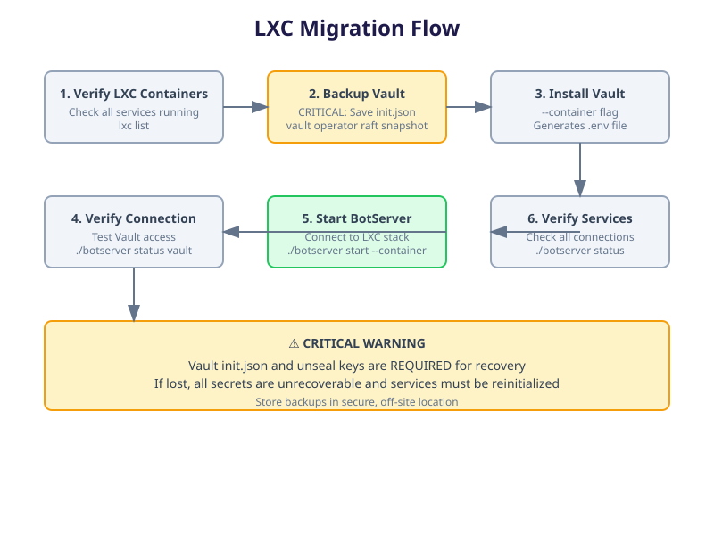

# Migrating BotServer to Incus Instances 🟡 BETA

How to attach a freshly installed botserver to a stack whose services already
run as **Incus** instances. Incus is the only supported container runtime here;
`lxc`/`lxd` are not.



## ⚠️ Vault data loss is permanent

Before touching anything:

1. Back up `botserver-stack/conf/vault/init.json` to storage outside the host.
2. Save the unseal keys (they are printed once, at `vault operator init`).
3. Take a raft snapshot:

```bash
export VAULT_ADDR=https://localhost:8200
export VAULT_SKIP_VERIFY=true
vault operator raft snapshot save /tmp/vault-snapshot.snap
```

If `init.json` and the unseal keys are lost, every secret is unrecoverable and
the stack must be re-initialised from scratch.

## Prerequisites

```bash
sudo apt install incus
sudo usermod -aG incus-admin "$USER"    # log out and back in
incus list
```

Check the services the migration will attach to:

```bash
curl -k https://localhost:8200/v1/sys/health   # Vault
pg_isready -h localhost -p 5432                # PostgreSQL
curl http://localhost:9000/minio/health/live   # Drive (MinIO)
redis-cli -h localhost -p 6379 ping            # Valkey
```

## Step 1: verify the instances

```bash
incus list
incus info vault
incus info postgres
incus info minio
incus info redis
incus info zitadel
```

Instance names follow `{tenant}-{component}` (see
[Container Deployment](../02-architecture-packages/containers.md)); adjust the
names above to yours.

## Step 2: install only Vault, in container mode

Installing a single component generates the `.env` file and the connection
material without recreating the other instances:

```bash
cd /path/to/botserver
./botserver bootstrap --container vault
```

This downloads the Vault binary, generates TLS certificates, writes the Vault
configuration, initialises Vault and writes `.env`.

## Step 3: verify `.env`

```bash
cat .env
# VAULT_ADDR=https://localhost:8200
# VAULT_TOKEN=<root_token>
# VAULT_CACERT=./botserver-stack/conf/system/certificates/ca/ca.crt
# VAULT_CACHE_TTL=300
```

Only `VAULT_*` variables belong in `.env`; every other credential is read from
Vault at boot.

## Step 4: verify the Vault connection

```bash
./botserver status vault

export VAULT_ADDR=https://localhost:8200
export VAULT_TOKEN=$(grep VAULT_TOKEN .env | cut -d= -f2)
export VAULT_CACERT=./botserver-stack/conf/system/certificates/ca/ca.crt
vault status
```

## Step 5: start botserver

```bash
./botserver start --container
```

It reads `.env`, connects to Vault, resolves the remaining credentials from
Vault and attaches to the running instances.

## Step 6: verify every service

```bash
./botserver status
./botserver status vault
./botserver status tables
./botserver status drive
./botserver status cache
./botserver status directory
```

## Troubleshooting

| Symptom | Check |
|---|---|
| Vault unreachable | `incus info vault`, `incus exec vault -- tail -100 /var/log/vault.log`, then `curl -k https://localhost:8200/v1/sys/health` |
| `.env` not generated | `tail -100 botserver-stack/logs/vault.log`; remove `botserver-stack/conf/vault/init.json` and re-run `./botserver bootstrap --container vault` |
| Secrets not found | `vault status` (must be unsealed), `vault kv list gbo/`; restore with `vault operator raft snapshot restore /tmp/vault-snapshot.snap` |
| Instance unreachable | `incus network list`, `incus network show <network>`, `incus exec vault -- ping <host>` |
| Vault sealed after reboot | unseal with the keys from step 0; bootstrap retries forever until Vault answers |

Instance addresses:

```bash
incus list --format json | jq -r '.[] | "\(.name): \(.state.network.eth0.addresses[0].address)"'
```

## Best practices

1. Back up Vault and PostgreSQL before migrating
   (`vault operator raft snapshot save`, `pg_dump`).
2. Record the instance names, network and port proxies.
3. Rehearse on a non-production host first.
4. Watch `botserver-stack/logs/botserver.log` and `…/vault.log` during the move.

## See also

- [Container Deployment (Incus)](../02-architecture-packages/containers.md)
- [Installation](../01-getting-started/installation.md)
- [Infrastructure Design](../02-architecture-packages/infrastructure.md)
