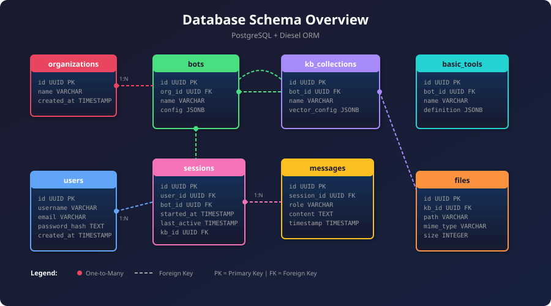
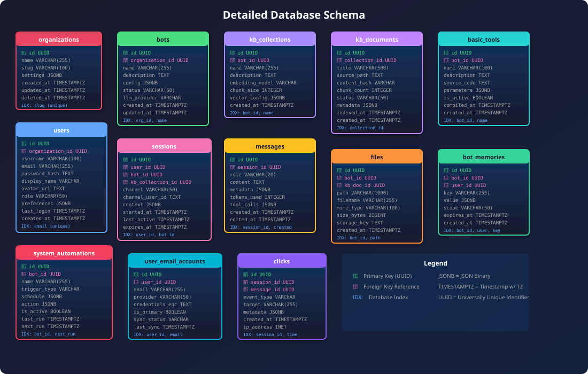
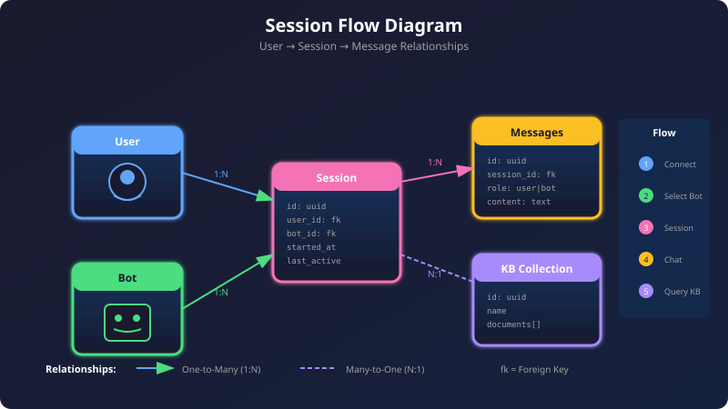
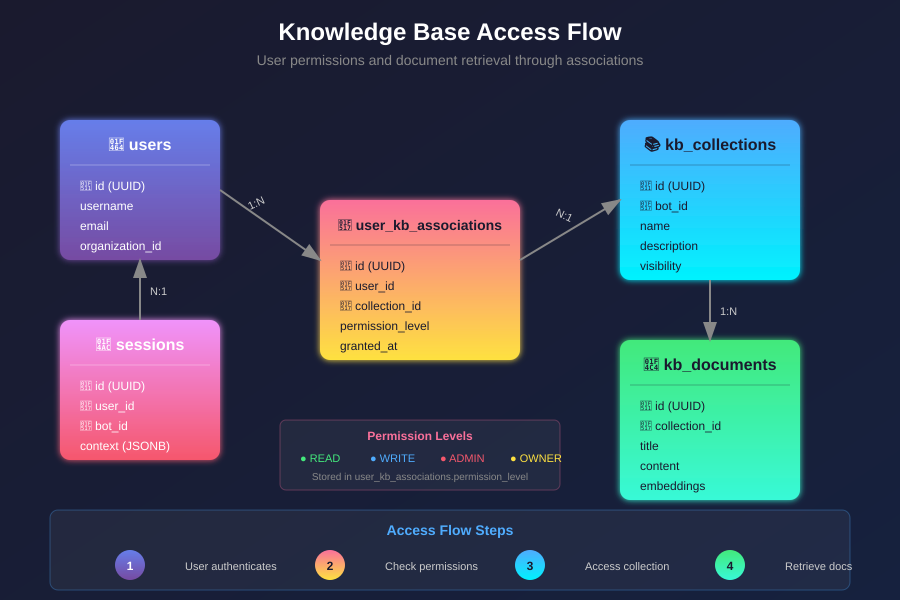

# Database Schema Overview 🟡 BETA

General Bots uses PostgreSQL as its primary database with Diesel ORM for type-safe database operations. The schema is designed to support multi-tenant bot hosting with comprehensive session management, user authentication, and content storage.

## Core Architecture

The database schema follows several key design principles. All tables use UUID primary keys for globally unique identifiers that work across distributed systems. Created and updated timestamps provide audit trails for tracking data changes. Foreign key relationships maintain referential integrity between related entities. JSON fields offer flexible storage for dynamic configuration and metadata that doesn't fit rigid schema definitions.

## Database Schema Diagram

## Entity Relationship Overview



### Core Tables Structure
## Detailed Schema



## Schema Reference Is Generated

Every table is documented in the [generated schema reference](./schema/index.md),
built from `botschema/src/**` (`table!`, `joinable!`) and
`botserver/migrations/*/up.sql`. Do not add table lists to this page: a
hand-written list drifts from the code, the generator cannot.

| Need | Page |
|---|---|
| All tables, grouped by domain, with columns/types/nullability/defaults/PK/FK and migration tag | [Generated schema reference](./schema/index.md) |
| Flat list of all tables | [Tables](./tables.md) |
| Every `joinable!` and SQL `REFERENCES` edge | [Relationships](./relationships.md) |
| Mermaid graph per domain | [Relationship pages](./relationships.md) |

Regenerate after any schema change:

```bash
python3 scripts/gen_schema_reference.py          # rewrite the pages
python3 scripts/gen_schema_reference.py --check  # fail when committed pages are stale
python3 scripts/gen_schema_reference.py --report # inventory, drift and per-domain counts
```

The generator reports drift but never fixes it: a table present in a migration
and absent from `botschema` (or the reverse) is a code issue, because
`botschema` is the single owner of every `table!` (see
`botschema/index.md`).

## Table Relationships

### Session Flow



### Knowledge Base Access



### Primary Relationships

The full edge list is generated in the [relationship reference](./relationships.md).
The shape is: organizations own branches and bots; bots own configuration,
memory, knowledge-base collections and tools; sessions join users to bots and
carry the conversation; knowledge-base collections contain documents; tool
associations link bots and sessions to the tools they may run.

## Data Types

The schema uses several PostgreSQL data types throughout. UUID fields serve as primary keys and foreign key references for globally unique identification. Text fields store variable-length string data without length constraints. Varchar fields hold fixed-length strings for codes and identifiers. Timestamptz fields store timestamps with timezone information for accurate time tracking across regions. Jsonb fields provide JSON storage with indexing capabilities for flexible schemas. Boolean fields represent binary flags and settings. Integer fields store counters and numeric values.

## Indexing Strategy

Primary indexes exist on all id fields serving as primary keys. Foreign key relationships receive indexes for efficient joins. Timestamp fields are indexed to support time-based queries. Session tokens have indexes for fast authentication lookups.

Composite indexes optimize common query patterns. The combination of bot_id and user_id enables efficient session lookup. Collection_id with document_id accelerates knowledge retrieval. User_id paired with created_at supports history queries ordered by time.

## Migration Management

Database migrations are managed through Diesel's migration system. Migrations reside in the `migrations/` directory with each migration containing both up.sql and down.sql files for applying and reverting changes. Version tracking occurs in the `__diesel_schema_migrations` table. The bootstrap process automatically applies pending migrations on startup.

## Performance Considerations

### Connection Pooling

The default connection pool maintains 10 connections to balance resource usage with concurrency. Pool size is configurable via environment variables for different deployment scales. Automatic connection recycling prevents stale connections from causing issues.

### Query Optimization

Prepared statements cache query plans for repeated queries, improving performance. Batch operations handle bulk inserts efficiently rather than individual row insertions. Lazy loading defers loading of related entities until needed. Pagination limits result sets to manageable sizes for large tables.

### Data Retention

Message history retention is configurable to balance storage costs with historical needs. Automatic cleanup removes expired sessions to free resources. An archival strategy moves old conversations to cold storage while maintaining accessibility.

## Security Features

### Data Protection

Password hashing uses the Argon2 algorithm for strong protection against brute-force attacks. AES-GCM encryption protects sensitive fields at rest. Secure random token generation creates unpredictable session identifiers. Diesel's parameterized queries prevent SQL injection attacks.

### Access Control

Row-level security is implemented through application logic that filters queries by user context. User isolation ensures sessions only access their own data. Bot isolation separates data by organization to prevent cross-tenant access. Audit logging records sensitive operations for compliance and security review.

## Backup Strategy

### Backup Types

Full database dumps capture complete point-in-time snapshots. Incremental WAL archiving provides continuous backup with minimal storage overhead. Point-in-time recovery support enables restoration to any moment within the retention window. Cross-region replication offers disaster recovery capabilities for critical deployments.

### Restore Procedures

Automated restore testing validates backup integrity on a regular schedule. Version compatibility checks ensure backups restore correctly to the current schema. Data integrity validation confirms restored data matches expected checksums. Zero-downtime migration support enables schema changes without service interruption.

## Monitoring

### Key Metrics

Connection pool usage indicates whether the pool size needs adjustment. Query execution time reveals slow queries requiring optimization. Table sizes and growth rates inform capacity planning. Index effectiveness metrics show whether indexes are being utilized. Lock contention monitoring identifies concurrency bottlenecks.

### Health Checks

Database connectivity verification ensures the connection pool can reach PostgreSQL. Migration status checks confirm all migrations have been applied. Replication lag monitoring applies to deployments with read replicas. Storage usage tracking prevents disk space exhaustion.

## Best Practices

Always use migrations for schema changes rather than manual DDL to maintain consistency across environments. Never modify production data directly through SQL clients to avoid bypassing application logic. Test migrations in development first to catch issues before they affect production. Monitor performance metrics regularly to identify degradation early. Plan capacity based on growth projections to avoid emergency scaling. Document changes in migration files with comments explaining the purpose of each change. Use transactions for data consistency when multiple tables must be updated together. Implement retry logic for transient failures like connection timeouts or deadlocks.

## Future Considerations

Partitioning for large tables like message_history would improve query performance and enable efficient data archival. Read replicas could scale read-heavy workloads across multiple database instances. Time-series optimization for metrics data would support analytics features. Full-text search indexes would enable natural language queries against stored content. Graph relationships could support advanced queries for interconnected data like conversation flows.