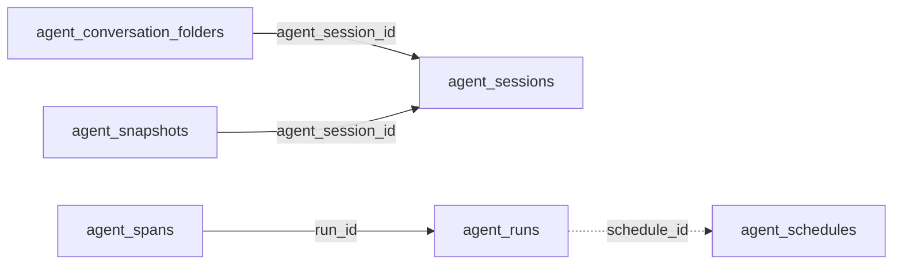

<!-- generated by scripts/gen_schema_reference.py — do not edit by hand -->

# Relationships: agents

Part of the [relationship reference](./../relationships.md). Dashed edges are
nullable foreign keys.

| From | Column | To | Nullable | Source |
|---|---|---|---|---|
| `agent_conversation_folders` | `agent_session_id` | `agent_sessions` | no | joinable! |
| `agent_runs` | `schedule_id` | `agent_schedules` | yes | joinable! |
| `agent_snapshots` | `agent_session_id` | `agent_sessions` | no | joinable! |
| `agent_spans` | `run_id` | `agent_runs` | no | joinable! |
