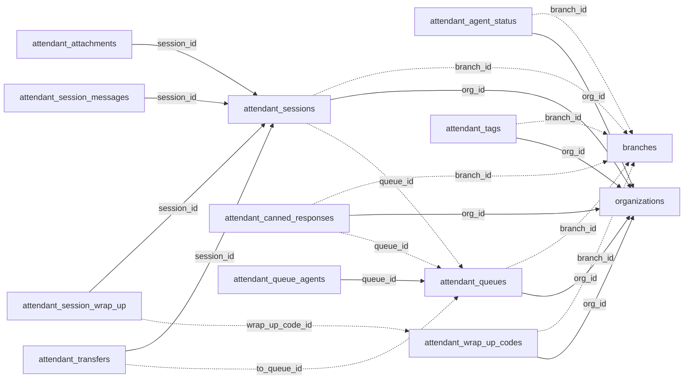

<!-- generated by scripts/gen_schema_reference.py — do not edit by hand -->

# Relationships: attendant

Part of the [relationship reference](./../relationships.md). Dashed edges are
nullable foreign keys.

| From | Column | To | Nullable | Source |
|---|---|---|---|---|
| `attendant_agent_status` | `branch_id` | `branches` | yes | joinable! |
| `attendant_agent_status` | `org_id` | `organizations` | no | migrations |
| `attendant_attachments` | `session_id` | `attendant_sessions` | no | joinable! |
| `attendant_canned_responses` | `branch_id` | `branches` | yes | joinable! |
| `attendant_canned_responses` | `org_id` | `organizations` | no | migrations |
| `attendant_canned_responses` | `queue_id` | `attendant_queues` | yes | migrations |
| `attendant_queue_agents` | `queue_id` | `attendant_queues` | no | joinable! |
| `attendant_queues` | `branch_id` | `branches` | yes | joinable! |
| `attendant_queues` | `org_id` | `organizations` | no | migrations |
| `attendant_session_messages` | `session_id` | `attendant_sessions` | no | joinable! |
| `attendant_session_wrap_up` | `session_id` | `attendant_sessions` | no | joinable! |
| `attendant_session_wrap_up` | `wrap_up_code_id` | `attendant_wrap_up_codes` | yes | joinable! |
| `attendant_sessions` | `branch_id` | `branches` | yes | joinable! |
| `attendant_sessions` | `org_id` | `organizations` | no | migrations |
| `attendant_sessions` | `queue_id` | `attendant_queues` | yes | joinable! |
| `attendant_tags` | `branch_id` | `branches` | yes | joinable! |
| `attendant_tags` | `org_id` | `organizations` | no | migrations |
| `attendant_transfers` | `session_id` | `attendant_sessions` | no | joinable! |
| `attendant_transfers` | `to_queue_id` | `attendant_queues` | yes | migrations |
| `attendant_wrap_up_codes` | `branch_id` | `branches` | yes | joinable! |
| `attendant_wrap_up_codes` | `org_id` | `organizations` | no | migrations |
