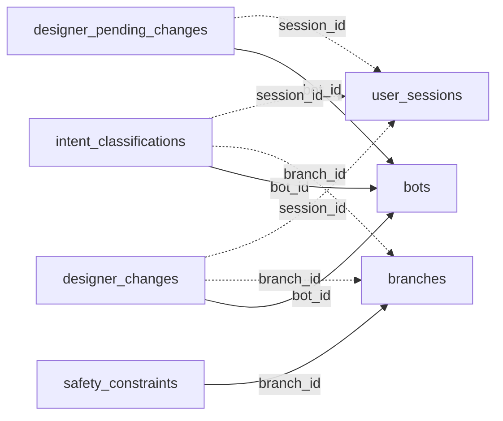

<!-- generated by scripts/gen_schema_reference.py — do not edit by hand -->

# Relationships: autotask

Part of the [relationship reference](./../relationships.md). Dashed edges are
nullable foreign keys.

| From | Column | To | Nullable | Source |
|---|---|---|---|---|
| `designer_changes` | `bot_id` | `bots` | no | migrations |
| `designer_changes` | `branch_id` | `branches` | yes | migrations |
| `designer_changes` | `session_id` | `user_sessions` | yes | migrations |
| `designer_pending_changes` | `bot_id` | `bots` | no | migrations |
| `designer_pending_changes` | `session_id` | `user_sessions` | yes | migrations |
| `intent_classifications` | `bot_id` | `bots` | no | migrations |
| `intent_classifications` | `branch_id` | `branches` | yes | migrations |
| `intent_classifications` | `session_id` | `user_sessions` | yes | migrations |
| `safety_constraints` | `branch_id` | `branches` | no | migrations |
