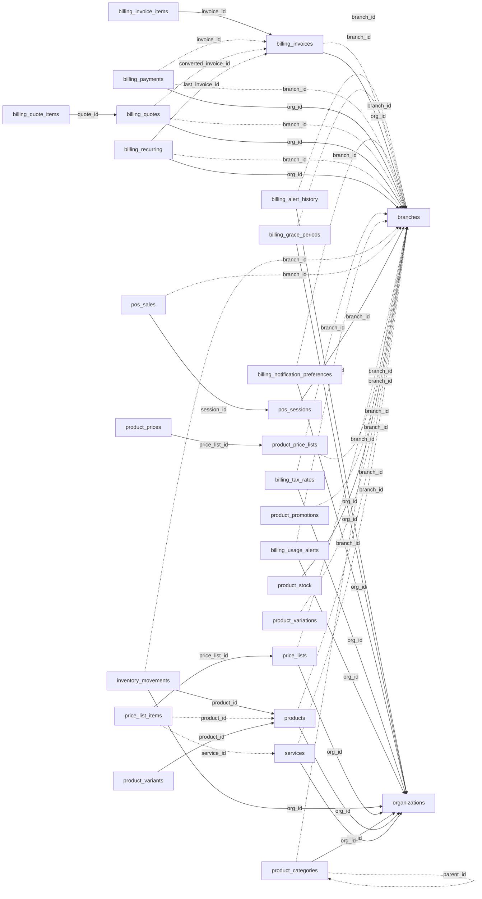

<!-- generated by scripts/gen_schema_reference.py — do not edit by hand -->

# Relationships: billing

Part of the [relationship reference](./../relationships.md). Dashed edges are
nullable foreign keys.

| From | Column | To | Nullable | Source |
|---|---|---|---|---|
| `billing_alert_history` | `branch_id` | `branches` | yes | joinable! |
| `billing_alert_history` | `org_id` | `organizations` | no | migrations |
| `billing_grace_periods` | `branch_id` | `branches` | yes | joinable! |
| `billing_grace_periods` | `org_id` | `organizations` | no | migrations |
| `billing_invoice_items` | `invoice_id` | `billing_invoices` | no | joinable! |
| `billing_invoices` | `branch_id` | `branches` | yes | joinable! |
| `billing_invoices` | `org_id` | `branches` | no | migrations |
| `billing_notification_preferences` | `branch_id` | `branches` | yes | joinable! |
| `billing_notification_preferences` | `org_id` | `organizations` | no | migrations |
| `billing_payments` | `branch_id` | `branches` | yes | joinable! |
| `billing_payments` | `invoice_id` | `billing_invoices` | yes | joinable! |
| `billing_payments` | `org_id` | `branches` | no | migrations |
| `billing_quote_items` | `quote_id` | `billing_quotes` | no | joinable! |
| `billing_quotes` | `branch_id` | `branches` | yes | joinable! |
| `billing_quotes` | `converted_invoice_id` | `billing_invoices` | yes | migrations |
| `billing_quotes` | `org_id` | `branches` | no | migrations |
| `billing_recurring` | `branch_id` | `branches` | yes | joinable! |
| `billing_recurring` | `last_invoice_id` | `billing_invoices` | yes | migrations |
| `billing_recurring` | `org_id` | `branches` | no | migrations |
| `billing_tax_rates` | `branch_id` | `branches` | yes | joinable! |
| `billing_tax_rates` | `org_id` | `organizations` | no | migrations |
| `billing_usage_alerts` | `branch_id` | `branches` | yes | joinable! |
| `billing_usage_alerts` | `org_id` | `organizations` | no | migrations |
| `inventory_movements` | `branch_id` | `branches` | yes | joinable! |
| `inventory_movements` | `org_id` | `organizations` | no | migrations |
| `inventory_movements` | `product_id` | `products` | no | joinable! |
| `pos_sales` | `branch_id` | `branches` | yes | migrations |
| `pos_sales` | `session_id` | `pos_sessions` | no | migrations |
| `pos_sessions` | `branch_id` | `branches` | no | migrations |
| `price_list_items` | `price_list_id` | `price_lists` | no | joinable! |
| `price_list_items` | `product_id` | `products` | yes | joinable! |
| `price_list_items` | `service_id` | `services` | yes | joinable! |
| `price_lists` | `branch_id` | `branches` | yes | joinable! |
| `price_lists` | `org_id` | `organizations` | no | migrations |
| `product_categories` | `branch_id` | `branches` | yes | joinable! |
| `product_categories` | `org_id` | `organizations` | no | migrations |
| `product_categories` | `parent_id` | `product_categories` | yes | migrations |
| `product_price_lists` | `branch_id` | `branches` | yes | migrations |
| `product_prices` | `price_list_id` | `product_price_lists` | no | migrations |
| `product_promotions` | `branch_id` | `branches` | yes | migrations |
| `product_stock` | `branch_id` | `branches` | no | migrations |
| `product_variants` | `product_id` | `products` | no | joinable! |
| `product_variations` | `branch_id` | `branches` | yes | migrations |
| `products` | `branch_id` | `branches` | yes | joinable! |
| `products` | `org_id` | `organizations` | no | migrations |
| `services` | `branch_id` | `branches` | yes | joinable! |
| `services` | `org_id` | `organizations` | no | migrations |
