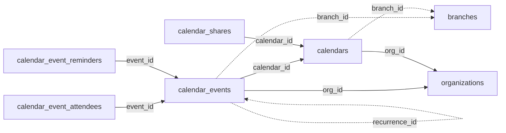

<!-- generated by scripts/gen_schema_reference.py — do not edit by hand -->

# Relationships: calendar

Part of the [relationship reference](./../relationships.md). Dashed edges are
nullable foreign keys.

| From | Column | To | Nullable | Source |
|---|---|---|---|---|
| `calendar_event_attendees` | `event_id` | `calendar_events` | no | joinable! |
| `calendar_event_reminders` | `event_id` | `calendar_events` | no | joinable! |
| `calendar_events` | `branch_id` | `branches` | yes | joinable! |
| `calendar_events` | `calendar_id` | `calendars` | no | joinable! |
| `calendar_events` | `org_id` | `organizations` | no | migrations |
| `calendar_events` | `recurrence_id` | `calendar_events` | yes | migrations |
| `calendar_shares` | `calendar_id` | `calendars` | no | joinable! |
| `calendars` | `branch_id` | `branches` | yes | joinable! |
| `calendars` | `org_id` | `organizations` | no | migrations |
