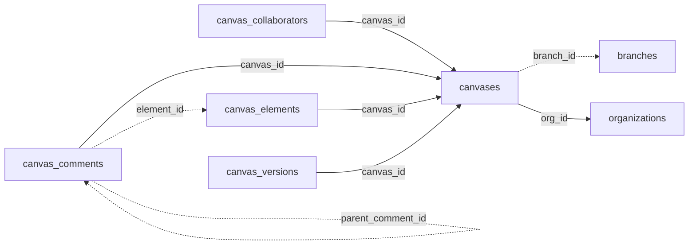

<!-- generated by scripts/gen_schema_reference.py — do not edit by hand -->

# Relationships: canvas

Part of the [relationship reference](./../relationships.md). Dashed edges are
nullable foreign keys.

| From | Column | To | Nullable | Source |
|---|---|---|---|---|
| `canvas_collaborators` | `canvas_id` | `canvases` | no | joinable! |
| `canvas_comments` | `canvas_id` | `canvases` | no | joinable! |
| `canvas_comments` | `element_id` | `canvas_elements` | yes | migrations |
| `canvas_comments` | `parent_comment_id` | `canvas_comments` | yes | migrations |
| `canvas_elements` | `canvas_id` | `canvases` | no | joinable! |
| `canvas_versions` | `canvas_id` | `canvases` | no | joinable! |
| `canvases` | `branch_id` | `branches` | yes | joinable! |
| `canvases` | `org_id` | `organizations` | no | migrations |
