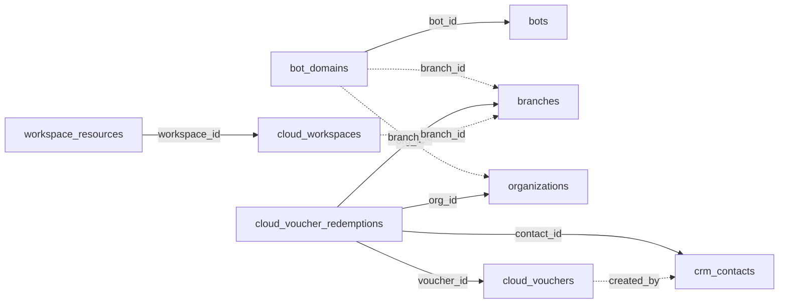

<!-- generated by scripts/gen_schema_reference.py — do not edit by hand -->

# Relationships: cloud

Part of the [relationship reference](./../relationships.md). Dashed edges are
nullable foreign keys.

| From | Column | To | Nullable | Source |
|---|---|---|---|---|
| `bot_domains` | `bot_id` | `bots` | no | migrations |
| `bot_domains` | `branch_id` | `branches` | yes | migrations |
| `bot_domains` | `org_id` | `organizations` | yes | migrations |
| `cloud_voucher_redemptions` | `branch_id` | `branches` | no | migrations |
| `cloud_voucher_redemptions` | `contact_id` | `crm_contacts` | no | migrations |
| `cloud_voucher_redemptions` | `org_id` | `organizations` | no | migrations |
| `cloud_voucher_redemptions` | `voucher_id` | `cloud_vouchers` | no | migrations |
| `cloud_vouchers` | `created_by` | `crm_contacts` | yes | migrations |
| `cloud_workspaces` | `branch_id` | `branches` | yes | migrations |
| `workspace_resources` | `workspace_id` | `cloud_workspaces` | no | migrations |
