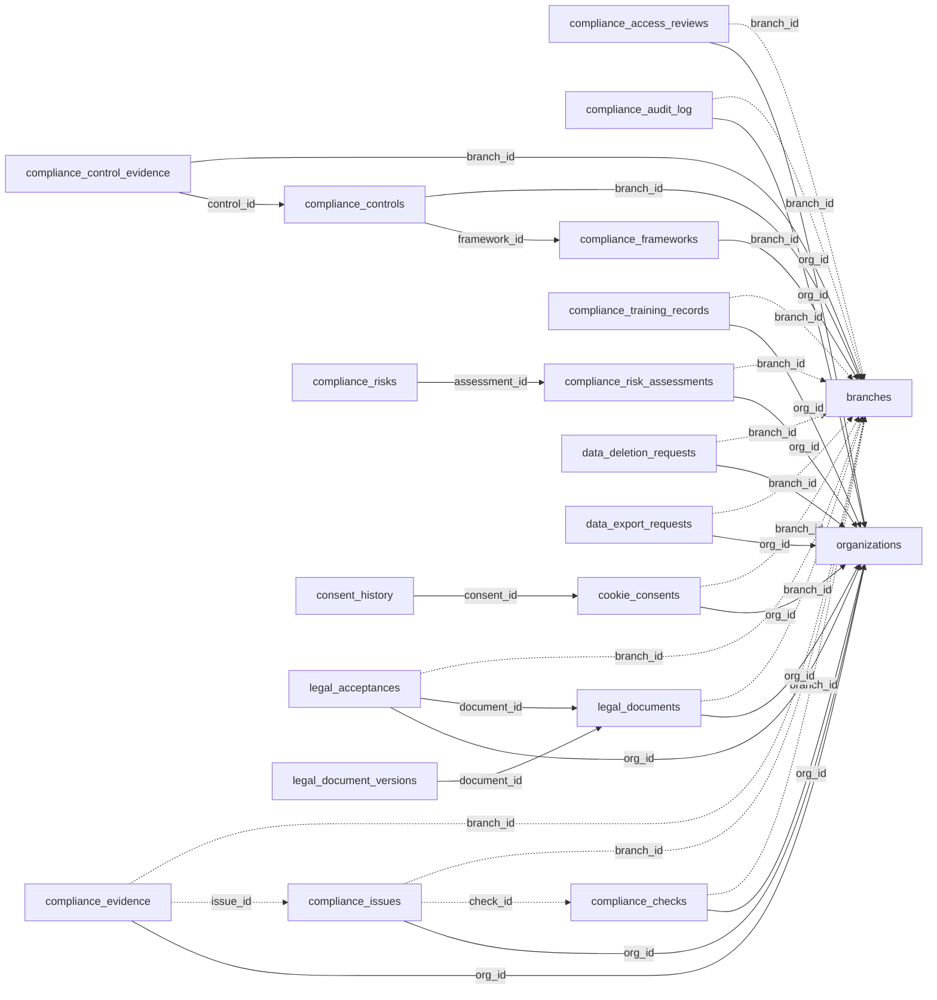

<!-- generated by scripts/gen_schema_reference.py — do not edit by hand -->

# Relationships: compliance

Part of the [relationship reference](./../relationships.md). Dashed edges are
nullable foreign keys.

| From | Column | To | Nullable | Source |
|---|---|---|---|---|
| `compliance_access_reviews` | `branch_id` | `branches` | yes | joinable! |
| `compliance_access_reviews` | `org_id` | `organizations` | no | migrations |
| `compliance_audit_log` | `branch_id` | `branches` | yes | joinable! |
| `compliance_audit_log` | `org_id` | `organizations` | no | migrations |
| `compliance_checks` | `branch_id` | `branches` | yes | joinable! |
| `compliance_checks` | `org_id` | `organizations` | no | migrations |
| `compliance_control_evidence` | `branch_id` | `branches` | no | joinable! |
| `compliance_control_evidence` | `control_id` | `compliance_controls` | no | joinable! |
| `compliance_controls` | `branch_id` | `branches` | no | joinable! |
| `compliance_controls` | `framework_id` | `compliance_frameworks` | no | joinable! |
| `compliance_evidence` | `branch_id` | `branches` | yes | joinable! |
| `compliance_evidence` | `issue_id` | `compliance_issues` | yes | migrations |
| `compliance_evidence` | `org_id` | `organizations` | no | migrations |
| `compliance_frameworks` | `branch_id` | `branches` | no | joinable! |
| `compliance_issues` | `branch_id` | `branches` | yes | joinable! |
| `compliance_issues` | `check_id` | `compliance_checks` | yes | joinable! |
| `compliance_issues` | `org_id` | `organizations` | no | migrations |
| `compliance_risk_assessments` | `branch_id` | `branches` | yes | joinable! |
| `compliance_risk_assessments` | `org_id` | `organizations` | no | migrations |
| `compliance_risks` | `assessment_id` | `compliance_risk_assessments` | no | joinable! |
| `compliance_training_records` | `branch_id` | `branches` | yes | joinable! |
| `compliance_training_records` | `org_id` | `organizations` | no | migrations |
| `consent_history` | `consent_id` | `cookie_consents` | no | joinable! |
| `cookie_consents` | `branch_id` | `branches` | yes | joinable! |
| `cookie_consents` | `org_id` | `organizations` | no | migrations |
| `data_deletion_requests` | `branch_id` | `branches` | yes | joinable! |
| `data_deletion_requests` | `org_id` | `organizations` | no | migrations |
| `data_export_requests` | `branch_id` | `branches` | yes | joinable! |
| `data_export_requests` | `org_id` | `organizations` | no | migrations |
| `legal_acceptances` | `branch_id` | `branches` | yes | joinable! |
| `legal_acceptances` | `document_id` | `legal_documents` | no | joinable! |
| `legal_acceptances` | `org_id` | `organizations` | no | migrations |
| `legal_document_versions` | `document_id` | `legal_documents` | no | joinable! |
| `legal_documents` | `branch_id` | `branches` | yes | joinable! |
| `legal_documents` | `org_id` | `organizations` | no | migrations |
