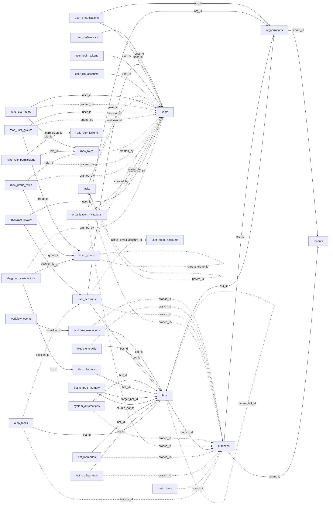

<!-- generated by scripts/gen_schema_reference.py — do not edit by hand -->

# Relationships: core

Part of the [relationship reference](./../relationships.md). Dashed edges are
nullable foreign keys.

| From | Column | To | Nullable | Source |
|---|---|---|---|---|
| `auto_tasks` | `bot_id` | `bots` | no | migrations |
| `auto_tasks` | `branch_id` | `branches` | yes | migrations |
| `auto_tasks` | `session_id` | `user_sessions` | yes | migrations |
| `basic_tools` | `branch_id` | `branches` | yes | migrations |
| `bot_configuration` | `bot_id` | `bots` | no | migrations |
| `bot_configuration` | `branch_id` | `branches` | yes | migrations |
| `bot_memories` | `bot_id` | `bots` | no | migrations |
| `bot_memories` | `branch_id` | `branches` | yes | migrations |
| `bot_shared_memory` | `source_bot_id` | `bots` | no | migrations |
| `bot_shared_memory` | `target_bot_id` | `bots` | no | migrations |
| `bots` | `branch_id` | `branches` | no | joinable! |
| `bots` | `org_id` | `organizations` | no | joinable! |
| `bots` | `parent_bot_id` | `bots` | yes | migrations |
| `branches` | `org_id` | `organizations` | no | joinable! |
| `branches` | `tenant_id` | `tenants` | no | joinable! |
| `kb_collections` | `bot_id` | `bots` | no | joinable! |
| `kb_group_associations` | `granted_by` | `users` | yes | migrations |
| `kb_group_associations` | `group_id` | `rbac_groups` | no | migrations |
| `kb_group_associations` | `kb_id` | `kb_collections` | no | joinable! |
| `message_history` | `session_id` | `user_sessions` | no | migrations |
| `message_history` | `user_id` | `users` | no | migrations |
| `organization_invitations` | `accepted_by` | `users` | yes | migrations |
| `organization_invitations` | `branch_id` | `branches` | yes | joinable! |
| `organization_invitations` | `invited_by` | `users` | no | migrations |
| `organization_invitations` | `org_id` | `organizations` | no | joinable! |
| `organizations` | `tenant_id` | `tenants` | no | joinable! |
| `rbac_group_roles` | `granted_by` | `users` | yes | migrations |
| `rbac_group_roles` | `group_id` | `rbac_groups` | no | joinable! |
| `rbac_group_roles` | `role_id` | `rbac_roles` | no | joinable! |
| `rbac_groups` | `created_by` | `users` | yes | migrations |
| `rbac_groups` | `parent_group_id` | `rbac_groups` | yes | migrations |
| `rbac_role_permissions` | `granted_by` | `users` | yes | migrations |
| `rbac_role_permissions` | `permission_id` | `rbac_permissions` | no | joinable! |
| `rbac_role_permissions` | `role_id` | `rbac_roles` | no | joinable! |
| `rbac_roles` | `created_by` | `users` | yes | migrations |
| `rbac_user_groups` | `added_by` | `users` | yes | migrations |
| `rbac_user_groups` | `group_id` | `rbac_groups` | no | joinable! |
| `rbac_user_groups` | `user_id` | `users` | no | joinable! |
| `rbac_user_roles` | `granted_by` | `users` | yes | migrations |
| `rbac_user_roles` | `role_id` | `rbac_roles` | no | joinable! |
| `rbac_user_roles` | `user_id` | `users` | no | joinable! |
| `system_automations` | `bot_id` | `bots` | no | migrations |
| `system_automations` | `branch_id` | `branches` | yes | migrations |
| `tasks` | `assignee_id` | `users` | yes | migrations |
| `tasks` | `branch_id` | `branches` | yes | migrations |
| `tasks` | `parent_id` | `tasks` | yes | migrations |
| `tasks` | `reporter_id` | `users` | yes | migrations |
| `user_llm_accounts` | `user_id` | `users` | no | migrations |
| `user_login_tokens` | `user_id` | `users` | no | migrations |
| `user_organizations` | `org_id` | `organizations` | no | joinable! |
| `user_organizations` | `user_id` | `users` | no | joinable! |
| `user_preferences` | `user_id` | `users` | no | migrations |
| `user_sessions` | `active_email_account_id` | `user_email_accounts` | yes | migrations |
| `user_sessions` | `bot_id` | `bots` | no | migrations |
| `user_sessions` | `branch_id` | `branches` | yes | migrations |
| `user_sessions` | `user_id` | `users` | no | migrations |
| `website_crawls` | `bot_id` | `bots` | no | joinable! |
| `website_crawls` | `branch_id` | `branches` | yes | migrations |
| `workflow_events` | `workflow_id` | `workflow_executions` | no | migrations |
| `workflow_executions` | `bot_id` | `bots` | no | migrations |
| `workflow_executions` | `branch_id` | `branches` | yes | migrations |
