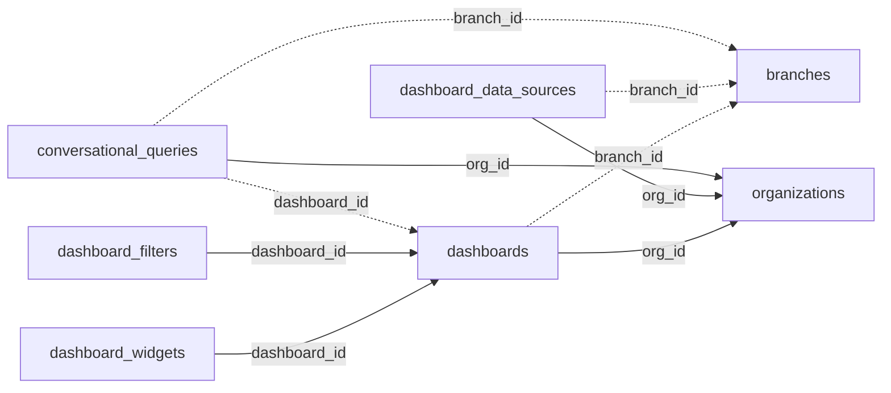

<!-- generated by scripts/gen_schema_reference.py — do not edit by hand -->

# Relationships: dashboards

Part of the [relationship reference](./../relationships.md). Dashed edges are
nullable foreign keys.

| From | Column | To | Nullable | Source |
|---|---|---|---|---|
| `conversational_queries` | `branch_id` | `branches` | yes | migrations |
| `conversational_queries` | `dashboard_id` | `dashboards` | yes | joinable! |
| `conversational_queries` | `org_id` | `organizations` | no | migrations |
| `dashboard_data_sources` | `branch_id` | `branches` | yes | migrations |
| `dashboard_data_sources` | `org_id` | `organizations` | no | migrations |
| `dashboard_filters` | `dashboard_id` | `dashboards` | no | joinable! |
| `dashboard_widgets` | `dashboard_id` | `dashboards` | no | joinable! |
| `dashboards` | `branch_id` | `branches` | yes | migrations |
| `dashboards` | `org_id` | `organizations` | no | migrations |
