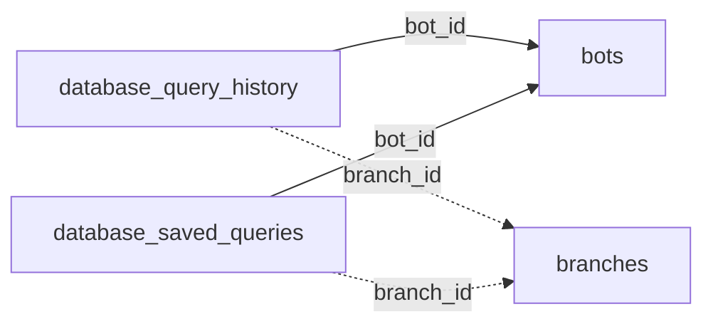

<!-- generated by scripts/gen_schema_reference.py — do not edit by hand -->

# Relationships: database_manager

Part of the [relationship reference](./../relationships.md). Dashed edges are
nullable foreign keys.

| From | Column | To | Nullable | Source |
|---|---|---|---|---|
| `database_query_history` | `bot_id` | `bots` | no | migrations |
| `database_query_history` | `branch_id` | `branches` | yes | migrations |
| `database_saved_queries` | `bot_id` | `bots` | no | migrations |
| `database_saved_queries` | `branch_id` | `branches` | yes | migrations |
