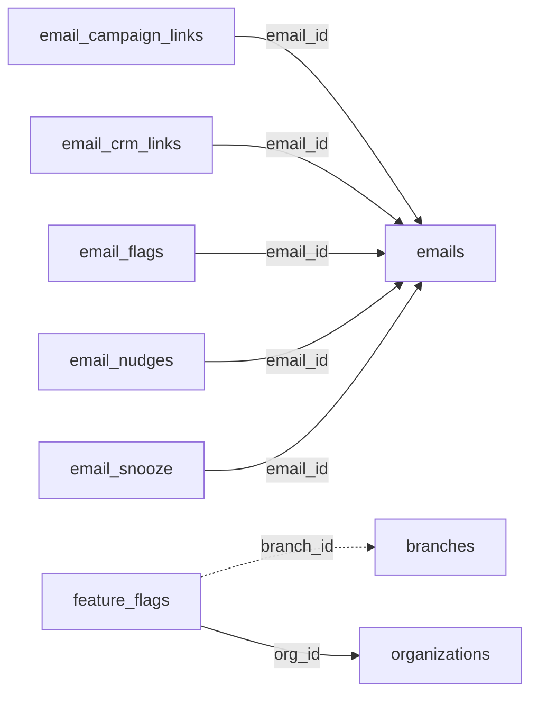

<!-- generated by scripts/gen_schema_reference.py — do not edit by hand -->

# Relationships: email_integration

Part of the [relationship reference](./../relationships.md). Dashed edges are
nullable foreign keys.

| From | Column | To | Nullable | Source |
|---|---|---|---|---|
| `email_campaign_links` | `email_id` | `emails` | no | migrations |
| `email_crm_links` | `email_id` | `emails` | no | migrations |
| `email_flags` | `email_id` | `emails` | no | migrations |
| `email_nudges` | `email_id` | `emails` | no | migrations |
| `email_snooze` | `email_id` | `emails` | no | migrations |
| `feature_flags` | `branch_id` | `branches` | yes | migrations |
| `feature_flags` | `org_id` | `organizations` | no | migrations |
