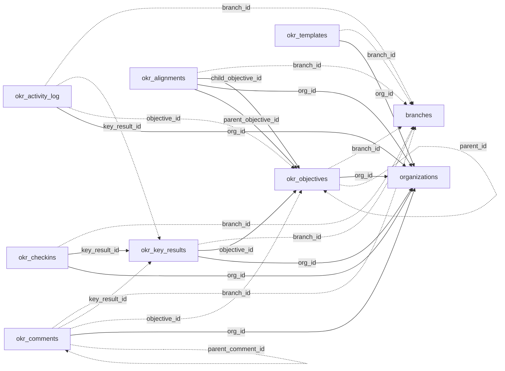

<!-- generated by scripts/gen_schema_reference.py — do not edit by hand -->

# Relationships: goals

Part of the [relationship reference](./../relationships.md). Dashed edges are
nullable foreign keys.

| From | Column | To | Nullable | Source |
|---|---|---|---|---|
| `okr_activity_log` | `branch_id` | `branches` | yes | joinable! |
| `okr_activity_log` | `key_result_id` | `okr_key_results` | yes | migrations |
| `okr_activity_log` | `objective_id` | `okr_objectives` | yes | migrations |
| `okr_activity_log` | `org_id` | `organizations` | no | migrations |
| `okr_alignments` | `branch_id` | `branches` | yes | joinable! |
| `okr_alignments` | `child_objective_id` | `okr_objectives` | no | migrations |
| `okr_alignments` | `org_id` | `organizations` | no | migrations |
| `okr_alignments` | `parent_objective_id` | `okr_objectives` | no | migrations |
| `okr_checkins` | `branch_id` | `branches` | yes | joinable! |
| `okr_checkins` | `key_result_id` | `okr_key_results` | no | joinable! |
| `okr_checkins` | `org_id` | `organizations` | no | migrations |
| `okr_comments` | `branch_id` | `branches` | yes | joinable! |
| `okr_comments` | `key_result_id` | `okr_key_results` | yes | migrations |
| `okr_comments` | `objective_id` | `okr_objectives` | yes | migrations |
| `okr_comments` | `org_id` | `organizations` | no | migrations |
| `okr_comments` | `parent_comment_id` | `okr_comments` | yes | migrations |
| `okr_key_results` | `branch_id` | `branches` | yes | joinable! |
| `okr_key_results` | `objective_id` | `okr_objectives` | no | joinable! |
| `okr_key_results` | `org_id` | `organizations` | no | migrations |
| `okr_objectives` | `branch_id` | `branches` | yes | joinable! |
| `okr_objectives` | `org_id` | `organizations` | no | migrations |
| `okr_objectives` | `parent_id` | `okr_objectives` | yes | migrations |
| `okr_templates` | `branch_id` | `branches` | yes | joinable! |
| `okr_templates` | `org_id` | `organizations` | no | migrations |
