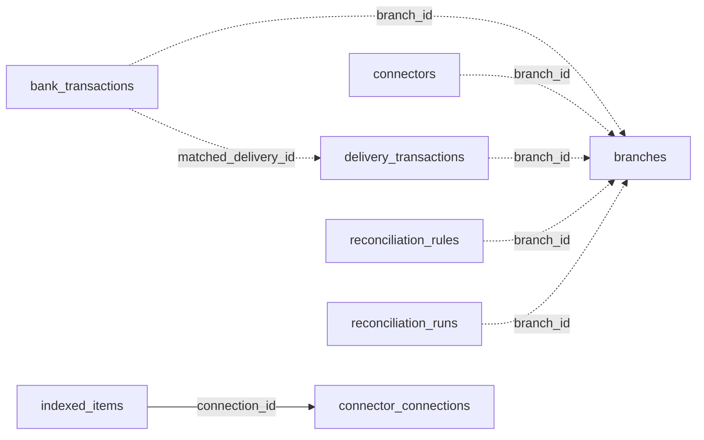

<!-- generated by scripts/gen_schema_reference.py — do not edit by hand -->

# Relationships: integrations

Part of the [relationship reference](./../relationships.md). Dashed edges are
nullable foreign keys.

| From | Column | To | Nullable | Source |
|---|---|---|---|---|
| `bank_transactions` | `branch_id` | `branches` | yes | migrations |
| `bank_transactions` | `matched_delivery_id` | `delivery_transactions` | yes | migrations |
| `connectors` | `branch_id` | `branches` | yes | migrations |
| `delivery_transactions` | `branch_id` | `branches` | yes | migrations |
| `indexed_items` | `connection_id` | `connector_connections` | no | joinable! |
| `reconciliation_rules` | `branch_id` | `branches` | yes | migrations |
| `reconciliation_runs` | `branch_id` | `branches` | yes | migrations |
