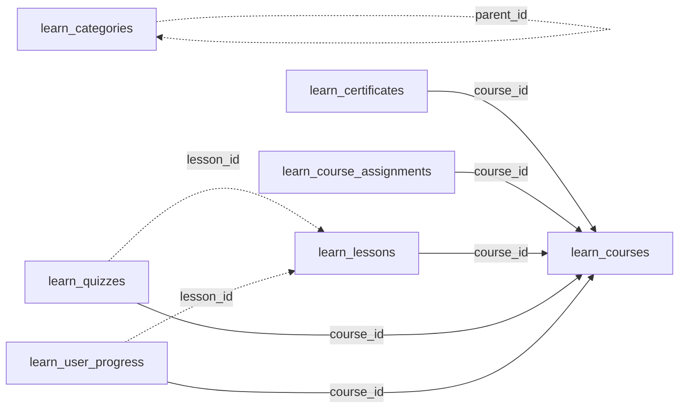

<!-- generated by scripts/gen_schema_reference.py — do not edit by hand -->

# Relationships: learn

Part of the [relationship reference](./../relationships.md). Dashed edges are
nullable foreign keys.

| From | Column | To | Nullable | Source |
|---|---|---|---|---|
| `learn_categories` | `parent_id` | `learn_categories` | yes | migrations |
| `learn_certificates` | `course_id` | `learn_courses` | no | migrations |
| `learn_course_assignments` | `course_id` | `learn_courses` | no | migrations |
| `learn_lessons` | `course_id` | `learn_courses` | no | migrations |
| `learn_quizzes` | `course_id` | `learn_courses` | no | migrations |
| `learn_quizzes` | `lesson_id` | `learn_lessons` | yes | migrations |
| `learn_user_progress` | `course_id` | `learn_courses` | no | migrations |
| `learn_user_progress` | `lesson_id` | `learn_lessons` | yes | migrations |
