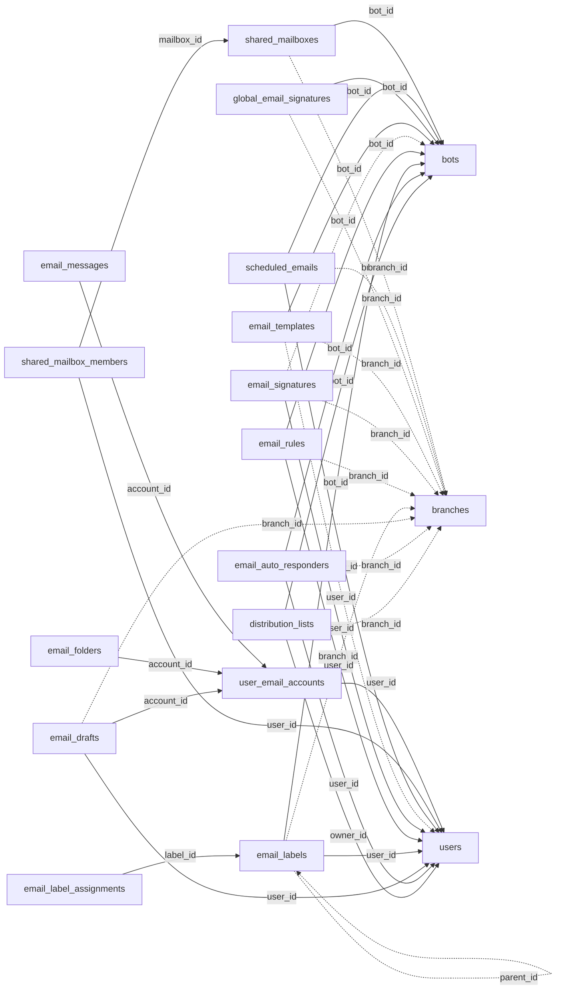

<!-- generated by scripts/gen_schema_reference.py — do not edit by hand -->

# Relationships: mail

Part of the [relationship reference](./../relationships.md). Dashed edges are
nullable foreign keys.

| From | Column | To | Nullable | Source |
|---|---|---|---|---|
| `distribution_lists` | `bot_id` | `bots` | no | migrations |
| `distribution_lists` | `branch_id` | `branches` | yes | migrations |
| `distribution_lists` | `owner_id` | `users` | no | migrations |
| `email_auto_responders` | `bot_id` | `bots` | no | migrations |
| `email_auto_responders` | `branch_id` | `branches` | yes | migrations |
| `email_auto_responders` | `user_id` | `users` | no | migrations |
| `email_drafts` | `account_id` | `user_email_accounts` | no | migrations |
| `email_drafts` | `branch_id` | `branches` | yes | migrations |
| `email_drafts` | `user_id` | `users` | no | migrations |
| `email_folders` | `account_id` | `user_email_accounts` | no | migrations |
| `email_label_assignments` | `label_id` | `email_labels` | no | migrations |
| `email_labels` | `bot_id` | `bots` | no | migrations |
| `email_labels` | `branch_id` | `branches` | yes | migrations |
| `email_labels` | `parent_id` | `email_labels` | yes | migrations |
| `email_labels` | `user_id` | `users` | no | migrations |
| `email_messages` | `account_id` | `user_email_accounts` | no | migrations |
| `email_rules` | `bot_id` | `bots` | no | migrations |
| `email_rules` | `branch_id` | `branches` | yes | migrations |
| `email_rules` | `user_id` | `users` | no | migrations |
| `email_signatures` | `bot_id` | `bots` | yes | migrations |
| `email_signatures` | `branch_id` | `branches` | yes | migrations |
| `email_signatures` | `user_id` | `users` | no | migrations |
| `email_templates` | `bot_id` | `bots` | no | migrations |
| `email_templates` | `branch_id` | `branches` | yes | migrations |
| `email_templates` | `user_id` | `users` | yes | migrations |
| `global_email_signatures` | `bot_id` | `bots` | no | migrations |
| `global_email_signatures` | `branch_id` | `branches` | yes | migrations |
| `scheduled_emails` | `bot_id` | `bots` | no | migrations |
| `scheduled_emails` | `branch_id` | `branches` | yes | migrations |
| `scheduled_emails` | `user_id` | `users` | no | migrations |
| `shared_mailbox_members` | `mailbox_id` | `shared_mailboxes` | no | migrations |
| `shared_mailbox_members` | `user_id` | `users` | no | migrations |
| `shared_mailboxes` | `bot_id` | `bots` | no | migrations |
| `shared_mailboxes` | `branch_id` | `branches` | yes | migrations |
| `user_email_accounts` | `user_id` | `users` | no | migrations |
