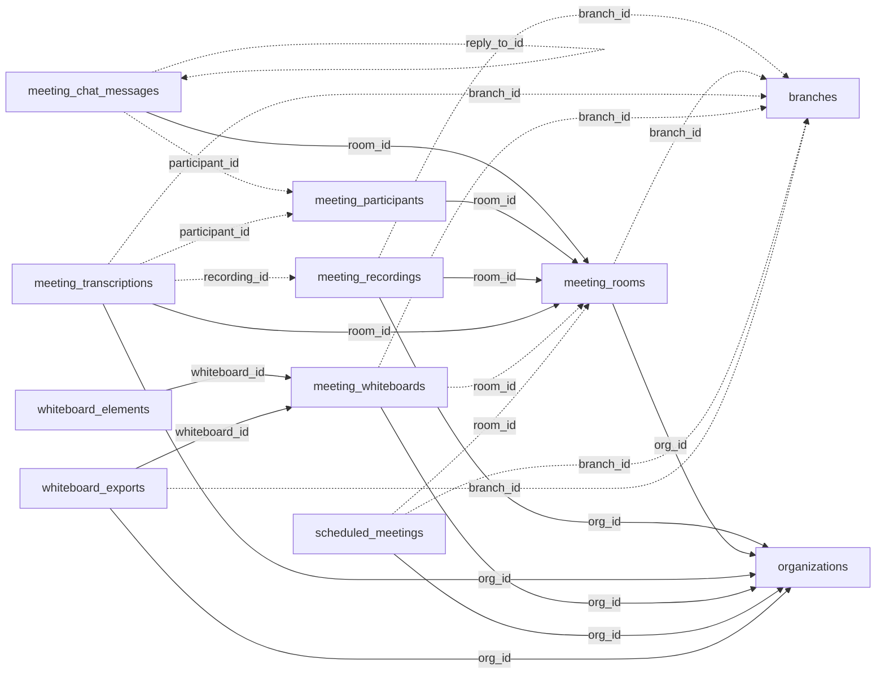

<!-- generated by scripts/gen_schema_reference.py — do not edit by hand -->

# Relationships: meet

Part of the [relationship reference](./../relationships.md). Dashed edges are
nullable foreign keys.

| From | Column | To | Nullable | Source |
|---|---|---|---|---|
| `meeting_chat_messages` | `participant_id` | `meeting_participants` | yes | joinable! |
| `meeting_chat_messages` | `reply_to_id` | `meeting_chat_messages` | yes | migrations |
| `meeting_chat_messages` | `room_id` | `meeting_rooms` | no | joinable! |
| `meeting_participants` | `room_id` | `meeting_rooms` | no | joinable! |
| `meeting_recordings` | `branch_id` | `branches` | yes | joinable! |
| `meeting_recordings` | `org_id` | `organizations` | no | migrations |
| `meeting_recordings` | `room_id` | `meeting_rooms` | no | joinable! |
| `meeting_rooms` | `branch_id` | `branches` | yes | joinable! |
| `meeting_rooms` | `org_id` | `organizations` | no | migrations |
| `meeting_transcriptions` | `branch_id` | `branches` | yes | migrations |
| `meeting_transcriptions` | `org_id` | `organizations` | no | migrations |
| `meeting_transcriptions` | `participant_id` | `meeting_participants` | yes | joinable! |
| `meeting_transcriptions` | `recording_id` | `meeting_recordings` | yes | joinable! |
| `meeting_transcriptions` | `room_id` | `meeting_rooms` | no | joinable! |
| `meeting_whiteboards` | `branch_id` | `branches` | yes | joinable! |
| `meeting_whiteboards` | `org_id` | `organizations` | no | migrations |
| `meeting_whiteboards` | `room_id` | `meeting_rooms` | yes | joinable! |
| `scheduled_meetings` | `branch_id` | `branches` | yes | joinable! |
| `scheduled_meetings` | `org_id` | `organizations` | no | migrations |
| `scheduled_meetings` | `room_id` | `meeting_rooms` | yes | joinable! |
| `whiteboard_elements` | `whiteboard_id` | `meeting_whiteboards` | no | joinable! |
| `whiteboard_exports` | `branch_id` | `branches` | yes | joinable! |
| `whiteboard_exports` | `org_id` | `organizations` | no | migrations |
| `whiteboard_exports` | `whiteboard_id` | `meeting_whiteboards` | no | joinable! |
