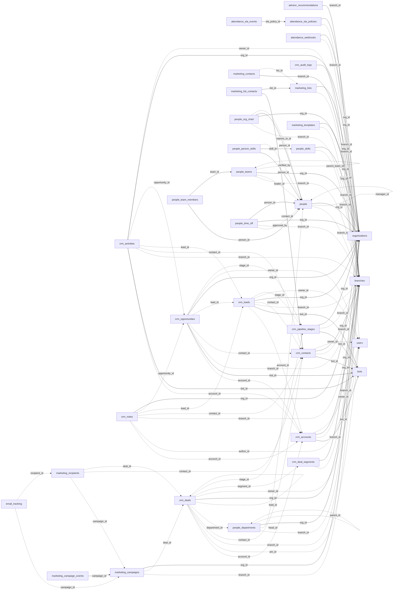

<!-- generated by scripts/gen_schema_reference.py — do not edit by hand -->

# Relationships: people

Part of the [relationship reference](./../relationships.md). Dashed edges are
nullable foreign keys.

| From | Column | To | Nullable | Source |
|---|---|---|---|---|
| `advisor_recommendations` | `branch_id` | `branches` | no | migrations |
| `attendance_sla_events` | `sla_policy_id` | `attendance_sla_policies` | no | joinable! |
| `attendance_sla_policies` | `branch_id` | `branches` | yes | migrations |
| `attendance_sla_policies` | `org_id` | `organizations` | no | migrations |
| `attendance_webhooks` | `branch_id` | `branches` | yes | migrations |
| `attendance_webhooks` | `org_id` | `organizations` | no | migrations |
| `crm_accounts` | `bot_id` | `bots` | no | migrations |
| `crm_accounts` | `branch_id` | `branches` | yes | migrations |
| `crm_accounts` | `org_id` | `branches` | no | migrations |
| `crm_accounts` | `owner_id` | `users` | yes | migrations |
| `crm_activities` | `account_id` | `crm_accounts` | yes | migrations |
| `crm_activities` | `bot_id` | `bots` | no | migrations |
| `crm_activities` | `branch_id` | `branches` | yes | migrations |
| `crm_activities` | `contact_id` | `crm_contacts` | yes | migrations |
| `crm_activities` | `lead_id` | `crm_leads` | yes | migrations |
| `crm_activities` | `opportunity_id` | `crm_opportunities` | yes | migrations |
| `crm_activities` | `org_id` | `organizations` | no | migrations |
| `crm_activities` | `owner_id` | `users` | yes | migrations |
| `crm_audit_logs` | `branch_id` | `branches` | no | joinable! |
| `crm_contacts` | `bot_id` | `bots` | no | migrations |
| `crm_contacts` | `branch_id` | `branches` | yes | migrations |
| `crm_contacts` | `org_id` | `branches` | no | migrations |
| `crm_contacts` | `owner_id` | `users` | yes | migrations |
| `crm_deal_segments` | `branch_id` | `branches` | yes | migrations |
| `crm_deal_segments` | `org_id` | `organizations` | no | migrations |
| `crm_deals` | `account_id` | `crm_accounts` | yes | migrations |
| `crm_deals` | `am_id` | `users` | yes | migrations |
| `crm_deals` | `branch_id` | `branches` | yes | migrations |
| `crm_deals` | `contact_id` | `crm_contacts` | yes | migrations |
| `crm_deals` | `department_id` | `people_departments` | yes | joinable! |
| `crm_deals` | `lead_id` | `crm_deals` | yes | migrations |
| `crm_deals` | `org_id` | `branches` | no | migrations |
| `crm_deals` | `owner_id` | `users` | yes | migrations |
| `crm_deals` | `segment_id` | `crm_deal_segments` | yes | migrations |
| `crm_deals` | `stage_id` | `crm_pipeline_stages` | yes | migrations |
| `crm_leads` | `account_id` | `crm_accounts` | yes | migrations |
| `crm_leads` | `bot_id` | `bots` | no | migrations |
| `crm_leads` | `branch_id` | `branches` | yes | migrations |
| `crm_leads` | `contact_id` | `crm_contacts` | yes | migrations |
| `crm_leads` | `org_id` | `organizations` | no | migrations |
| `crm_leads` | `owner_id` | `users` | yes | migrations |
| `crm_leads` | `stage_id` | `crm_pipeline_stages` | yes | migrations |
| `crm_notes` | `account_id` | `crm_accounts` | yes | migrations |
| `crm_notes` | `author_id` | `users` | yes | migrations |
| `crm_notes` | `branch_id` | `branches` | yes | joinable! |
| `crm_notes` | `contact_id` | `crm_contacts` | yes | migrations |
| `crm_notes` | `lead_id` | `crm_leads` | yes | migrations |
| `crm_notes` | `opportunity_id` | `crm_opportunities` | yes | migrations |
| `crm_notes` | `org_id` | `organizations` | no | migrations |
| `crm_opportunities` | `account_id` | `crm_accounts` | yes | migrations |
| `crm_opportunities` | `bot_id` | `bots` | no | migrations |
| `crm_opportunities` | `branch_id` | `branches` | yes | migrations |
| `crm_opportunities` | `contact_id` | `crm_contacts` | yes | migrations |
| `crm_opportunities` | `lead_id` | `crm_leads` | yes | migrations |
| `crm_opportunities` | `org_id` | `organizations` | no | migrations |
| `crm_opportunities` | `owner_id` | `users` | yes | migrations |
| `crm_opportunities` | `stage_id` | `crm_pipeline_stages` | yes | migrations |
| `crm_pipeline_stages` | `bot_id` | `bots` | no | migrations |
| `crm_pipeline_stages` | `branch_id` | `branches` | yes | migrations |
| `crm_pipeline_stages` | `org_id` | `organizations` | no | migrations |
| `email_tracking` | `campaign_id` | `marketing_campaigns` | yes | migrations |
| `email_tracking` | `recipient_id` | `marketing_recipients` | yes | migrations |
| `marketing_campaign_events` | `campaign_id` | `marketing_campaigns` | no | migrations |
| `marketing_campaigns` | `branch_id` | `branches` | yes | migrations |
| `marketing_campaigns` | `deal_id` | `crm_deals` | yes | migrations |
| `marketing_campaigns` | `org_id` | `organizations` | no | migrations |
| `marketing_contacts` | `branch_id` | `branches` | no | migrations |
| `marketing_contacts` | `list_id` | `marketing_lists` | yes | migrations |
| `marketing_list_contacts` | `contact_id` | `crm_contacts` | no | migrations |
| `marketing_list_contacts` | `list_id` | `marketing_lists` | no | migrations |
| `marketing_lists` | `branch_id` | `branches` | yes | migrations |
| `marketing_lists` | `org_id` | `organizations` | no | migrations |
| `marketing_recipients` | `campaign_id` | `marketing_campaigns` | yes | migrations |
| `marketing_recipients` | `contact_id` | `crm_contacts` | yes | migrations |
| `marketing_recipients` | `deal_id` | `crm_deals` | yes | migrations |
| `marketing_templates` | `branch_id` | `branches` | yes | migrations |
| `marketing_templates` | `org_id` | `organizations` | no | migrations |
| `people` | `branch_id` | `branches` | yes | joinable! |
| `people` | `manager_id` | `people` | yes | migrations |
| `people` | `org_id` | `organizations` | no | migrations |
| `people_departments` | `branch_id` | `branches` | yes | joinable! |
| `people_departments` | `head_id` | `people` | yes | migrations |
| `people_departments` | `org_id` | `organizations` | no | migrations |
| `people_departments` | `parent_id` | `people_departments` | yes | migrations |
| `people_org_chart` | `branch_id` | `branches` | yes | joinable! |
| `people_org_chart` | `org_id` | `organizations` | no | migrations |
| `people_org_chart` | `person_id` | `people` | no | migrations |
| `people_org_chart` | `reports_to_id` | `people` | yes | migrations |
| `people_person_skills` | `person_id` | `people` | no | joinable! |
| `people_person_skills` | `skill_id` | `people_skills` | no | joinable! |
| `people_person_skills` | `verified_by` | `people` | yes | migrations |
| `people_skills` | `branch_id` | `branches` | yes | joinable! |
| `people_skills` | `org_id` | `organizations` | no | migrations |
| `people_team_members` | `person_id` | `people` | no | joinable! |
| `people_team_members` | `team_id` | `people_teams` | no | joinable! |
| `people_teams` | `branch_id` | `branches` | yes | joinable! |
| `people_teams` | `leader_id` | `people` | yes | migrations |
| `people_teams` | `org_id` | `organizations` | no | migrations |
| `people_teams` | `parent_team_id` | `people_teams` | yes | migrations |
| `people_time_off` | `approved_by` | `people` | yes | migrations |
| `people_time_off` | `branch_id` | `branches` | yes | joinable! |
| `people_time_off` | `org_id` | `organizations` | no | migrations |
| `people_time_off` | `person_id` | `people` | no | migrations |
