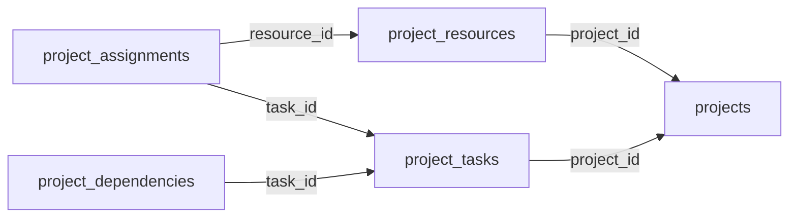

<!-- generated by scripts/gen_schema_reference.py — do not edit by hand -->

# Relationships: project

Part of the [relationship reference](./../relationships.md). Dashed edges are
nullable foreign keys.

| From | Column | To | Nullable | Source |
|---|---|---|---|---|
| `project_assignments` | `resource_id` | `project_resources` | no | joinable! |
| `project_assignments` | `task_id` | `project_tasks` | no | joinable! |
| `project_dependencies` | `task_id` | `project_tasks` | no | joinable! |
| `project_resources` | `project_id` | `projects` | no | joinable! |
| `project_tasks` | `project_id` | `projects` | no | joinable! |
