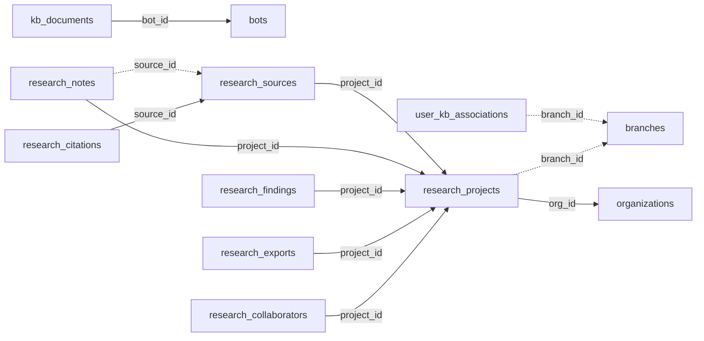

<!-- generated by scripts/gen_schema_reference.py — do not edit by hand -->

# Relationships: research

Part of the [relationship reference](./../relationships.md). Dashed edges are
nullable foreign keys.

| From | Column | To | Nullable | Source |
|---|---|---|---|---|
| `kb_documents` | `bot_id` | `bots` | no | migrations |
| `research_citations` | `source_id` | `research_sources` | no | joinable! |
| `research_collaborators` | `project_id` | `research_projects` | no | joinable! |
| `research_exports` | `project_id` | `research_projects` | no | joinable! |
| `research_findings` | `project_id` | `research_projects` | no | joinable! |
| `research_notes` | `project_id` | `research_projects` | no | joinable! |
| `research_notes` | `source_id` | `research_sources` | yes | migrations |
| `research_projects` | `branch_id` | `branches` | yes | joinable! |
| `research_projects` | `org_id` | `organizations` | no | migrations |
| `research_sources` | `project_id` | `research_projects` | no | joinable! |
| `user_kb_associations` | `branch_id` | `branches` | yes | migrations |
