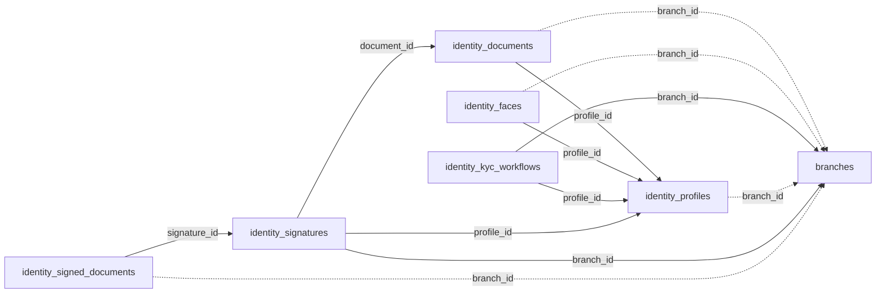

<!-- generated by scripts/gen_schema_reference.py — do not edit by hand -->

# Relationships: security

Part of the [relationship reference](./../relationships.md). Dashed edges are
nullable foreign keys.

| From | Column | To | Nullable | Source |
|---|---|---|---|---|
| `identity_documents` | `branch_id` | `branches` | yes | migrations |
| `identity_documents` | `profile_id` | `identity_profiles` | no | migrations |
| `identity_faces` | `branch_id` | `branches` | yes | migrations |
| `identity_faces` | `profile_id` | `identity_profiles` | no | migrations |
| `identity_kyc_workflows` | `branch_id` | `branches` | no | migrations |
| `identity_kyc_workflows` | `profile_id` | `identity_profiles` | no | migrations |
| `identity_profiles` | `branch_id` | `branches` | yes | migrations |
| `identity_signatures` | `branch_id` | `branches` | no | migrations |
| `identity_signatures` | `document_id` | `identity_documents` | no | migrations |
| `identity_signatures` | `profile_id` | `identity_profiles` | no | migrations |
| `identity_signed_documents` | `branch_id` | `branches` | yes | migrations |
| `identity_signed_documents` | `signature_id` | `identity_signatures` | no | migrations |
