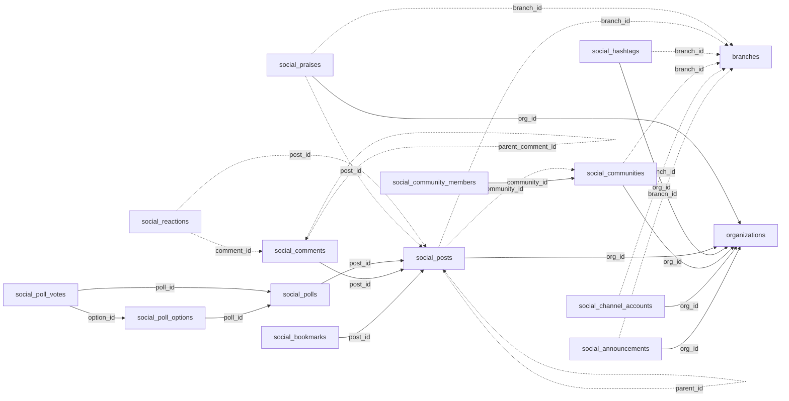

<!-- generated by scripts/gen_schema_reference.py — do not edit by hand -->

# Relationships: social

Part of the [relationship reference](./../relationships.md). Dashed edges are
nullable foreign keys.

| From | Column | To | Nullable | Source |
|---|---|---|---|---|
| `social_announcements` | `branch_id` | `branches` | yes | joinable! |
| `social_announcements` | `org_id` | `organizations` | no | migrations |
| `social_bookmarks` | `post_id` | `social_posts` | no | joinable! |
| `social_channel_accounts` | `branch_id` | `branches` | yes | joinable! |
| `social_channel_accounts` | `org_id` | `organizations` | no | migrations |
| `social_comments` | `parent_comment_id` | `social_comments` | yes | migrations |
| `social_comments` | `post_id` | `social_posts` | no | joinable! |
| `social_communities` | `branch_id` | `branches` | yes | joinable! |
| `social_communities` | `org_id` | `organizations` | no | migrations |
| `social_community_members` | `community_id` | `social_communities` | no | joinable! |
| `social_hashtags` | `branch_id` | `branches` | yes | joinable! |
| `social_hashtags` | `org_id` | `organizations` | no | migrations |
| `social_poll_options` | `poll_id` | `social_polls` | no | joinable! |
| `social_poll_votes` | `option_id` | `social_poll_options` | no | joinable! |
| `social_poll_votes` | `poll_id` | `social_polls` | no | joinable! |
| `social_polls` | `post_id` | `social_posts` | no | joinable! |
| `social_posts` | `branch_id` | `branches` | yes | joinable! |
| `social_posts` | `community_id` | `social_communities` | yes | migrations |
| `social_posts` | `org_id` | `organizations` | no | migrations |
| `social_posts` | `parent_id` | `social_posts` | yes | migrations |
| `social_praises` | `branch_id` | `branches` | yes | joinable! |
| `social_praises` | `org_id` | `organizations` | no | migrations |
| `social_praises` | `post_id` | `social_posts` | yes | migrations |
| `social_reactions` | `comment_id` | `social_comments` | yes | migrations |
| `social_reactions` | `post_id` | `social_posts` | yes | migrations |
