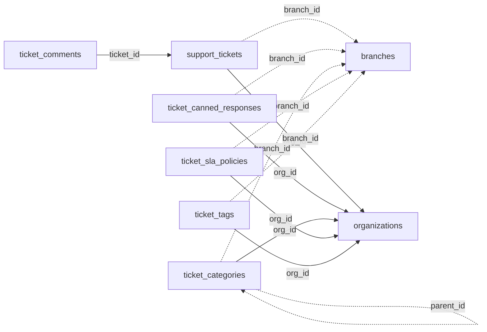

<!-- generated by scripts/gen_schema_reference.py — do not edit by hand -->

# Relationships: tickets

Part of the [relationship reference](./../relationships.md). Dashed edges are
nullable foreign keys.

| From | Column | To | Nullable | Source |
|---|---|---|---|---|
| `support_tickets` | `branch_id` | `branches` | yes | migrations |
| `support_tickets` | `org_id` | `organizations` | no | migrations |
| `ticket_canned_responses` | `branch_id` | `branches` | yes | migrations |
| `ticket_canned_responses` | `org_id` | `organizations` | no | migrations |
| `ticket_categories` | `branch_id` | `branches` | yes | migrations |
| `ticket_categories` | `org_id` | `organizations` | no | migrations |
| `ticket_categories` | `parent_id` | `ticket_categories` | yes | migrations |
| `ticket_comments` | `ticket_id` | `support_tickets` | no | migrations |
| `ticket_sla_policies` | `branch_id` | `branches` | yes | migrations |
| `ticket_sla_policies` | `org_id` | `organizations` | no | migrations |
| `ticket_tags` | `branch_id` | `branches` | yes | migrations |
| `ticket_tags` | `org_id` | `organizations` | no | migrations |
