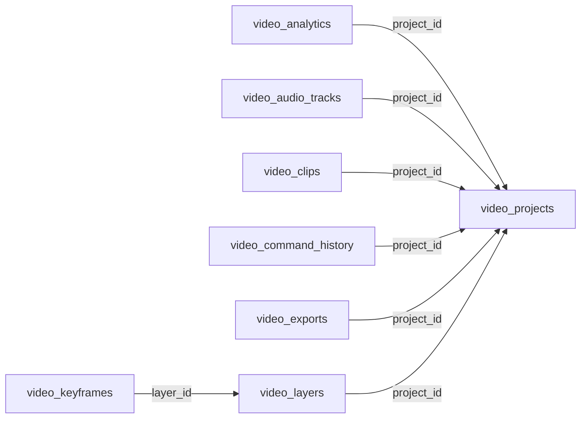

<!-- generated by scripts/gen_schema_reference.py — do not edit by hand -->

# Relationships: video

Part of the [relationship reference](./../relationships.md). Dashed edges are
nullable foreign keys.

| From | Column | To | Nullable | Source |
|---|---|---|---|---|
| `video_analytics` | `project_id` | `video_projects` | no | joinable! |
| `video_audio_tracks` | `project_id` | `video_projects` | no | joinable! |
| `video_clips` | `project_id` | `video_projects` | no | joinable! |
| `video_command_history` | `project_id` | `video_projects` | no | joinable! |
| `video_exports` | `project_id` | `video_projects` | no | joinable! |
| `video_keyframes` | `layer_id` | `video_layers` | no | joinable! |
| `video_layers` | `project_id` | `video_projects` | no | joinable! |
