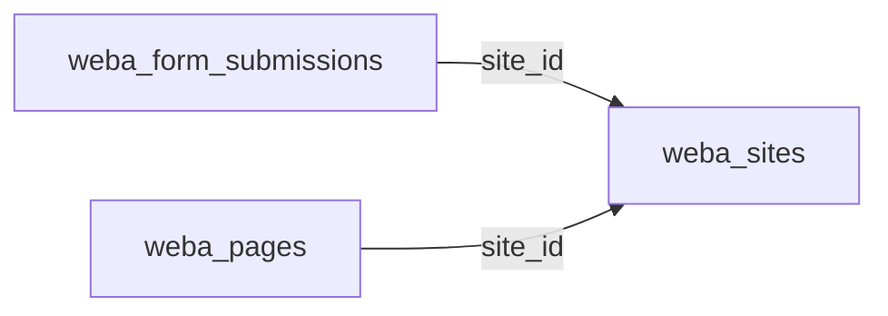

<!-- generated by scripts/gen_schema_reference.py — do not edit by hand -->

# Relationships: weba

Part of the [relationship reference](./../relationships.md). Dashed edges are
nullable foreign keys.

| From | Column | To | Nullable | Source |
|---|---|---|---|---|
| `weba_form_submissions` | `site_id` | `weba_sites` | no | joinable! |
| `weba_pages` | `site_id` | `weba_sites` | no | joinable! |
