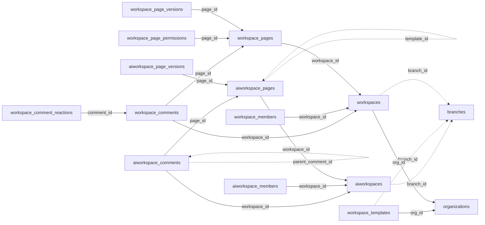

<!-- generated by scripts/gen_schema_reference.py — do not edit by hand -->

# Relationships: workspaces

Part of the [relationship reference](./../relationships.md). Dashed edges are
nullable foreign keys.

| From | Column | To | Nullable | Source |
|---|---|---|---|---|
| `aiworkspace_comments` | `page_id` | `aiworkspace_pages` | no | joinable! |
| `aiworkspace_comments` | `parent_comment_id` | `aiworkspace_comments` | yes | migrations |
| `aiworkspace_comments` | `workspace_id` | `aiworkspaces` | no | joinable! |
| `aiworkspace_members` | `workspace_id` | `aiworkspaces` | no | joinable! |
| `aiworkspace_page_versions` | `page_id` | `aiworkspace_pages` | no | joinable! |
| `aiworkspace_pages` | `parent_id` | `aiworkspace_pages` | yes | migrations |
| `aiworkspace_pages` | `template_id` | `aiworkspace_pages` | yes | migrations |
| `aiworkspace_pages` | `workspace_id` | `aiworkspaces` | no | joinable! |
| `aiworkspaces` | `branch_id` | `branches` | yes | migrations |
| `workspace_comment_reactions` | `comment_id` | `workspace_comments` | no | joinable! |
| `workspace_comments` | `page_id` | `workspace_pages` | no | joinable! |
| `workspace_comments` | `workspace_id` | `workspaces` | no | joinable! |
| `workspace_members` | `workspace_id` | `workspaces` | no | joinable! |
| `workspace_page_permissions` | `page_id` | `workspace_pages` | no | joinable! |
| `workspace_page_versions` | `page_id` | `workspace_pages` | no | joinable! |
| `workspace_pages` | `workspace_id` | `workspaces` | no | joinable! |
| `workspace_templates` | `branch_id` | `branches` | yes | joinable! |
| `workspace_templates` | `org_id` | `organizations` | no | migrations |
| `workspaces` | `branch_id` | `branches` | yes | joinable! |
| `workspaces` | `org_id` | `organizations` | no | migrations |
